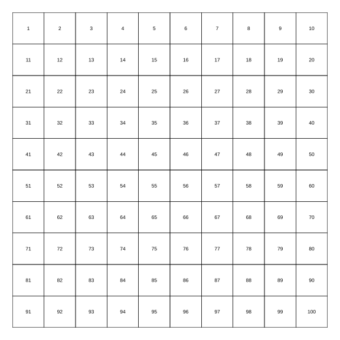

# Assignment 11

> **Definition 2.3.1** (Counting and Number Composition)  $10$ ones make $1$ ten, and $10$ tens make one hundred. Some tens and some ones combine to make a ten-something; for example, $4$ tens and $6$ ones combine to make forty-six.
>
> **Definition 2.3.2** (Place Value)  From the right, the first digit is the ones place, the second is the tens place, and the third is the hundreds place. Reading and writing numbers both start from the highest place.
>
> **Definition 2.3.3** (Comparing Two-Digit Numbers)  To compare two two-digit numbers, first compare the tens digit; the number with the larger tens digit is larger. If the tens digits are the same, then compare the ones digit.
>
> **Definition 2.3.4** (A Little More and Much More More)  When two numbers differ little, say "a little larger" or "a little smaller"; when they differ greatly, say "much larger" or "much smaller."
>
> **Definition 2.3.5** (Round-Tens Plus a One-Digit Number and Corresponding Subtraction)  Some tens and some ones combine to make a ten-something; e.g. $30+2=32$, $32-2=30$, $32-30=2$.

### Exercise 45

(Lesson: Counting and Number Composition, Try It) Count: adding $1$ to thirty-nine is $\_\_$; $10$ ones is $1$ $\_\_$; $\_\_$ tens is $\_\_$.

### Solution to Exercise 45

By **Definition 2.3.1** (Counting and Number Composition), adding $1$ to thirty-nine is forty; $10$ ones is $1$ ten; $10$ tens is one hundred. $\blacksquare$

### Exercise 46

(Lesson: Counting and Number Composition, Do It, Problem 1) Fill in: $\_\_$ tens and $\_\_$ ones combine to make $\_\_$.

### Solution to Exercise 46

By **Definition 2.3.1** (Counting and Number Composition), count the tens and ones in the picture, combine them and write the corresponding number. $\blacksquare$

### Exercise 47

(Lesson: Counting and Number Composition, Do It, Problem 2) Count how many bubbles it blew.

### Solution to Exercise 47

By **Definition 2.3.1** (Counting and Number Composition), count the bubbles one by one and write the corresponding number. $\blacksquare$

### Exercise 48

(Lesson: Counting and Number Composition, Do It, Problem 3) First circle out $10$ beads, then estimate about how many there are on the right in total; count to see whether the estimate is accurate.

### Solution to Exercise 48

First circle out $10$ beads as a standard, then estimate the total, finally count the actual number one by one, and compare the estimate with the actual. $\blacksquare$

### Exercise 49

(Lesson: Reading and Writing Numbers, Do It, Problem 1) How many buttons of each color are there? There are twenty-seven, thirty-three, and forty. Do the two "$3$"s in $33$ mean the same thing?

### Solution to Exercise 49

By **Definition 2.3.2** (Place Value), in $33$ the $3$ in the tens place represents $3$ tens, and the $3$ in the ones place represents $3$ ones; the two "$3$"s do not mean the same thing. $\blacksquare$

### Exercise 50

(Lesson: Reading and Writing Numbers, Do It, Problem 2) Write the following numbers: sixty-three, thirty-eight, fifty-five, ninety.

### Solution to Exercise 50

By **Definition 2.3.2** (Place Value) and **Definition 2.3.1** (Counting and Number Composition): write $63$, $38$, $55$, $90$. $\blacksquare$

### Exercise 51

(Lesson: Reading and Writing Numbers, Do It, Problem 3) I say you place: what number is formed by $5$ tens and $8$ ones?

### Solution to Exercise 51

By **Definition 2.3.1** (Counting and Number Composition), the number formed by $5$ tens and $8$ ones is $58$. $\blacksquare$

### Exercise 52

(Lesson: Number Order and Comparing Size, Count and Recognize) Adding $1$ to $99$ gives what? $10$ tens is what?

### Solution to Exercise 52

By **Definition 2.3.1** (Counting and Number Composition), adding $1$ to $99$ gives one hundred, and $10$ tens is one hundred. $\blacksquare$

### Exercise 53

(Lesson: Number Order and Comparing Size, Do It, Problem 1) Represent $1$ one, $1$ ten, and $1$ hundred on the counter, read them, then write them out.

### Solution to Exercise 53

By **Definition 2.3.2** (Place Value), $1$ one writes $1$ in the ones place, $1$ ten writes $1$ in the tens place, $1$ hundred writes $1$ in the hundreds place, i.e. $1$, $10$, $100$. $\blacksquare$

### Exercise 54

(Lesson: Number Order and Comparing Size, Practice, Problem 1) Write the following numbers: seventy-six, thirty, one hundred, eighty-eight.

### Solution to Exercise 54

By **Definition 2.3.2** (Place Value): write $76$, $30$, $100$, $88$. $\blacksquare$

### Exercise 55

(Lesson: Number Order and Comparing Size, Practice, Problem 2) Write as required: classify the numbers with ones digit $5$ and those with ones digit $0$ respectively ($45,50,70,60,65,55,75,95,85,90,80,100$).

### Solution to Exercise 55

By **Definition 2.3.2** (Place Value), those with ones digit $5$ are $45,65,55,75,95,85$; those with ones digit $0$ are $50,70,60,90,80,100$. $\blacksquare$

### Exercise 56

(Lesson: Number Order and Comparing Size, Hundreds Table) Fill in the numbers in the blanks of the hundreds table in numerical order, and talk about interesting arrangements you find.

### Solution to Exercise 56

By **Definition 2.3.3** (Comparing Two-Digit Numbers), each row from left to right increases by $1$, and each column from top to bottom increases by $10$; numbers with the same tens digit or same ones digit form a row or column.

{width=50%} $\blacksquare$

### Exercise 57

(Lesson: Number Order and Comparing Size, Compare) Fill "$>$""$<$" or "$=$" in $\bigcirc$: $41\bigcirc45$, $63\bigcirc53$, $89\bigcirc98$, $47\bigcirc32$, $63\bigcirc68$, $37\bigcirc73$, $81\bigcirc18$, $29\bigcirc30$.

### Solution to Exercise 57

By **Definition 2.3.3** (Comparing Two-Digit Numbers): $41<45$, $63>53$, $89<98$, $47>32$, $63<68$, $37<73$, $81>18$, $29<30$. $\blacksquare$

### Exercise 58

(Lesson: Number Order and Comparing Size, Do It, Problem 1) Fill in and compare: $87$, $31$, $25$, $99$; use "much larger" and "a little larger" to describe.

### Solution to Exercise 58

By **Definition 2.3.4** (A Little More and Much More More), from smallest to largest $25<31<87<99$; $87$ is much larger than $25$, $31$ is a little larger than $25$, and $99$ is a little larger than $87$. $\blacksquare$

### Exercise 59

(Lesson: Number Order and Comparing Size, Do It, Problem 2) I ate $35$ pests, Doudou ate much more than me, and Tiaotiao ate a little fewer than me. How many might Doudou and Tiaotiao each have eaten? ($80$, $40$, $28$)

### Solution to Exercise 59

By **Definition 2.3.4** (A Little More and Much More More), much more than $35$ choose $80$, a little fewer than $35$ choose $28$; thus Doudou ate $80$ and Tiaotiao ate $28$. $\blacksquare$

### Exercise 60

(Lesson: Number Order and Comparing Size, Practice, Problem 1) Write and dial: twenty-two, thirty-six, fifty-one, seventy-two, forty, twenty-seven, eighty-nine, ninety-five, one hundred.

### Solution to Exercise 60

By **Definition 2.3.2** (Place Value) and **Definition 2.3.1** (Counting and Number Composition), write $22$, $36$, $51$, $72$, $40$, $27$, $89$, $95$, $100$, and dial them on the counter. $\blacksquare$

### Exercise 61

(Lesson: Number Order and Comparing Size, Practice, Problem 2) Fill in the appropriate number in $\square$: $70$, $71$, $72$, $\_\_$, $\_\_$, $76$, $\_\_$, $79$. Is $77$ closer to $70$ or closer to $80$? What about $72$?

### Solution to Exercise 61

Fill in order $73,74,75,77,78$. $77$ is nearer to $80$, i.e. closer to $80$; $72$ is nearer to $70$, i.e. closer to $70$. $\blacksquare$

### Exercise 62

(Lesson: Number Order and Comparing Size, Practice, Problem 3) Connect: divide $29,96,85,80,56,61,51,38,48,26,74$ into "numbers greater than $60$" and "numbers less than $60$."

### Solution to Exercise 62

By **Definition 2.3.3** (Comparing Two-Digit Numbers), those greater than $60$ are $96,85,80,61,74$; those less than $60$ are $29,56,51,38,48,26$. $\blacksquare$

### Exercise 63

(Lesson: Simple Addition and Subtraction, Do It) Calculate: $10+20$, $20+10$, $30-20$, $30-10$; $30+2$, $2+30$, $32-2$, $32-30$.

### Solution to Exercise 63

By **Definition 2.3.5** (Round-Tens Plus a One-Digit Number and Corresponding Subtraction) and **Definition 2.3.1** (Counting and Number Composition): $10+20=30$, $20+10=30$, $30-20=10$, $30-10=20$; $30+2=32$, $2+30=32$, $32-2=30$, $32-30=2$. $\blacksquare$

### Exercise 64

(Lesson: Simple Addition and Subtraction, Do It Continued) Calculate: $70+2$, $40+4$, $5+60$; $72-2$, $44-4$, $65-5$; $72-70$, $44-40$, $65-60$.

### Solution to Exercise 64

By **Definition 2.3.5** (Round-Tens Plus a One-Digit Number and Corresponding Subtraction): $70+2=72$, $40+4=44$, $5+60=65$; $72-2=70$, $44-4=40$, $65-5=60$; $72-70=2$, $44-40=4$, $65-60=5$. $\blacksquare$

### Exercise 65

(Lesson: Place It and Think) Using $2$ discs on the tens and ones places, how many different numbers can be placed? What about $3$? What do you notice?

### Solution to Exercise 65

By **Definition 2.3.1** (Counting and Number Composition) and **Definition 2.3.2** (Place Value), $2$ discs can form $2$, $11$, $20$, totaling $3$ numbers; $3$ discs can form $3$, $12$, $21$, $30$, totaling $4$ numbers. Each additional $1$ disc gives $1$ more number. $\blacksquare$

### Exercise 66

(Lesson: Understanding Numbers Within 100, Practice, Problem 1) Read the following numbers: No. $86$ Xingfu Road, calcium tablets $31$, $60$ tablets.

### Solution to Exercise 66

By **Definition 2.3.2** (Place Value), read as eighty-six, thirty-one, sixty. $\blacksquare$

### Exercise 67

(Lesson: Understanding Numbers Within 100, Practice, Problem 2) Say which round-ten number each of the following is closer to: $36$, $48$, $32$, $59$, $64$.

### Solution to Exercise 67

See which round-ten number it is closer to: $36$ is close to $40$, $48$ is close to $50$, $32$ is close to $30$, $59$ is close to $60$, $64$ is close to $60$. $\blacksquare$

### Exercise 68

(Lesson: Understanding Numbers Within 100, Practice, Problem 3) Card-drawing game: can form $58$ or $85$. (1) If two identical cards are drawn, which two-digit numbers can be formed? (2) If one card is "$7$", which two-digit numbers can be formed?

### Solution to Exercise 68

By **Definition 2.3.2** (Place Value), (1) two identical cards can only form $11,22,...,99$; (2) if one card is $7$, can form $17,71,27,72,...,97,79$, etc. (the other card takes $1\sim9$ respectively). $\blacksquare$
