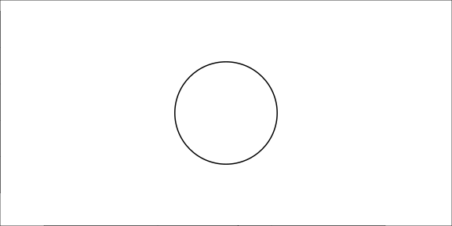
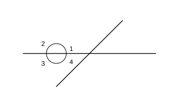

# Assignment 51

> **Definition 7.3.1** (Angles Revisited)  An angle can be seen as the figure formed by a ray rotating about its endpoint from one position to another. Rotating half a turn forms a straight angle, rotating a full turn forms a full angle, and rotating a quarter turn forms a right angle.
>
> **Definition 7.3.2** (Classification of Angles)  Acute angle: $0^{\circ}<$ acute angle $<90^{\circ}$; right angle $=90^{\circ}$; obtuse angle: $90^{\circ}<$ obtuse angle $<180^{\circ}$; straight angle $=180^{\circ}$; full angle $=360^{\circ}$. $1$ full angle $=2$ straight angles $=4$ right angles.
>
> **Definition 7.3.3** (The Unit for Measuring Angles)  Divide a circle evenly into $360$ parts; the angle facing $1$ of these parts is taken as the unit for measuring angles, and its size is $1$ degree, written $1^{\circ}$. A protractor is made by dividing a semicircle into $180$ equal parts.
>
> **Definition 7.3.4** (How to Measure an Angle)  Match the center of the protractor with the vertex of the angle, match the $0^{\circ}$ graduation line with one side of the angle, and the graduation on the protractor opposite the other side is the degree measure of this angle.
>
> **Definition 7.3.5** (How to Draw an Angle)  First draw a ray, matching the protractor center with the ray's endpoint and the $0^{\circ}$ graduation line with the ray; mark a point at the target graduation; taking the ray's endpoint as endpoint, draw another ray through the point just marked.

{width=100%}

### Exercise 50

(Lesson: Angles Revisited — Do It) What kind of angle is each of the following? Write the name of each angle.

### Solution to Exercise 50

By **Definition 7.3.2** (Classification of Angles), less than $90^{\circ}$ is an acute angle, equal to $90^{\circ}$ is a right angle, greater than $90^{\circ}$ and less than $180^{\circ}$ is an obtuse angle, equal to $180^{\circ}$ is a straight angle, and equal to $360^{\circ}$ is a full angle. $\blacksquare$

### Exercise 51

(Lesson: Measuring Angles — Do It, Problem 1) Read the graduations on the protractor and fill in the degree of each angle (two protractor pictures).

### Solution to Exercise 51

By **Definition 7.3.4** (How to Measure an Angle), one side of the angle matches the $0^{\circ}$ graduation line, and the graduation opposite the other side is the degree of the angle; just read it from the actual graduation in the picture. $\blacksquare$

### Exercise 52

(Lesson: Measuring Angles — Do It, Problem 2) Measure the degrees of the following two angles and compare their sizes. What do you find?

### Solution to Exercise 52

By **Definition 7.3.4** (How to Measure an Angle), measure the two angles and compare. We find that the size of an angle does not depend on the length of its sides but only on how wide the two sides open. $\blacksquare$

### Exercise 53

(Lesson: Drawing Angles — Do It, Problem 1) Measure the degree of each of the following angles.

### Solution to Exercise 53

By **Definition 7.3.4** (How to Measure an Angle), measure each angle's degree following the measuring steps. $\blacksquare$

### Exercise 54

(Lesson: Drawing Angles — Do It, Problem 2) Draw angles of $75^{\circ}$ and $105^{\circ}$.

### Solution to Exercise 54

By **Definition 7.3.5** (How to Draw an Angle), first draw a ray, align the protractor center with the endpoint and the $0^{\circ}$ line with the ray, mark a point at the $75^{\circ}$ and $105^{\circ}$ graduations, then draw the ray. $\blacksquare$

### Exercise 55

(Lesson: Drawing Angles — Do It, Problem 3) Draw the following angles: $20^{\circ}$, $30^{\circ}$, $85^{\circ}$, $120^{\circ}$, $135^{\circ}$.

### Solution to Exercise 55

By **Definition 7.3.5** (How to Draw an Angle), draw each angle. Among them, $20^{\circ}$, $30^{\circ}$, $85^{\circ}$ are acute, and $120^{\circ}$, $135^{\circ}$ are obtuse. $\blacksquare$

### Exercise 56

(Lesson: Practice 5, Problem 1) Measure the degree of each of the following angles: $\angle1$, $\angle2$, $\angle3$, $\angle4$, $\angle5$.

### Solution to Exercise 56

By **Definition 7.3.4** (How to Measure an Angle), read each angle's degree from the protractor. $\blacksquare$

### Exercise 57

(Lesson: Practice 5, Problem 2) On the protractor, taking ray $OA$ as one side, draw two $50^{\circ}$ angles opening in different directions.

### Solution to Exercise 57

By **Definition 7.3.5** (How to Draw an Angle), one angle opens to the upper right and one to the upper left, and the angle between the sides and $OA$ is $50^{\circ}$ in both. $\blacksquare$

### Exercise 58

(Lesson: Practice 5, Problem 3) Say what kind of angle each of the following is.

### Solution to Exercise 58

By **Definition 7.3.2** (Classification of Angles), judge by degree: less than $90^{\circ}$ acute, equal to $90^{\circ}$ right, $90^{\circ}\sim180^{\circ}$ obtuse, $180^{\circ}$ straight, $360^{\circ}$ full. $\blacksquare$

### Exercise 59

(Lesson: Practice 5, Problem 4) Measure and compute. (1) Measure $\angle1$, $\angle2$, $\angle3$ and sum them. (2) Measure $\angle1$, $\angle2$. (3) With a pair of set squares, what other degree angles can you put together?

### Solution to Exercise 59

By **Definition 7.3.4** (How to Measure an Angle), measure each angle. A pair of set squares has angles $30^{\circ},60^{\circ},90^{\circ}$ and $45^{\circ},45^{\circ},90^{\circ}$, and can form $15^{\circ},75^{\circ},105^{\circ},120^{\circ},135^{\circ},150^{\circ},180^{\circ}$ and so on. $\blacksquare$

### Exercise 60

(Lesson: Practice 5, Problem 5) Measure the degrees of the following angles; what can you find? The four angles formed by two intersecting straight lines.

### Solution to Exercise 60

By **Definition 7.3.4** (How to Measure an Angle), measure $\angle1,\angle2,\angle3,\angle4$. We find that vertical angles are equal, and two adjacent angles sum to $180^{\circ}$. $\blacksquare$

### Exercise 61

(Lesson: Practice 5, Problem 6) Compare and observe: (1) A line segment of length $1$ cm contains ( ) units of $1$ cm. (2) A rectangle's area contains ( ) units of $1$ cm$^2$. (3) An angle's degree contains ( ) units of $1^{\circ}$. I find that measuring length, area and angles all means counting how many corresponding units the measured figure contains.

### Solution to Exercise 61

By **Definition 7.3.3** (The Unit for Measuring Angles): (1) The line segment contains $1$ unit of $1$ cm; (2) the rectangle's area contains several units of $1$ cm$^2$; (3) the angle contains several units of $1^{\circ}$. Measuring means counting how many corresponding measuring units the measured figure contains. $\blacksquare$

### Exercise 62

(Lesson: Practice 5, Problem 7) Find a way to learn the degrees of the following two angles (the sides of the angles are not long enough).

### Solution to Exercise 62

By **Definition 7.3.4** (How to Measure an Angle), extend the two sides of the angle with a ruler and then measure with the protractor; the size of the angle does not depend on the length of the sides. $\blacksquare$

### Exercise 63

(Lesson: Practice 5, Problem 8) Count and fill: drawing $2$ rays from one point forms ( ) angles; drawing $3$ rays from one point forms ( ) angles. If one more ray is added, how many angles are formed?

### Solution to Exercise 63

$2$ rays form $1$ angle; $3$ rays form $3$ angles ($3\times2\div2=3$); $4$ rays form $6$ angles ($4\times3\div2=6$). $n$ rays form $n(n-1)\div2$ angles. $\blacksquare$

### Exercise 64

(Lesson: Information Technology Application) Command a robot to deliver food: starting at the pickup counter facing table ①, use combinations of "go straight N grids" and "turn left N degrees" to deliver to table ① and return; deliver and return along the route ①→④→③; deliver and return along the route ①→②→③→④→③.

### Solution to Exercise 64

Combine commands by direction and distance: go straight $3$ grids to table ①, turn left $180^{\circ}$, go straight $3$ grids back to the pickup counter; use loop commands to simplify the repeated path. $\blacksquare$

### Exercise 65

(Lesson: Practice 6, Problem 1) Measure the degree of each of the following angles.

### Solution to Exercise 65

By **Definition 7.3.4** (How to Measure an Angle), measure each angle's degree one by one. $\blacksquare$

### Exercise 66

(Lesson: Practice 6, Problem 2) Choose a suitable method to draw the following angles, and say what kind each is: $70^{\circ}$, $60^{\circ}$, $115^{\circ}$, $150^{\circ}$, $45^{\circ}$, $180^{\circ}$.

### Solution to Exercise 66

By **Definition 7.3.5** (How to Draw an Angle) draw the angles, and by **Definition 7.3.2** (Classification of Angles) judge: $70^{\circ}$ acute, $60^{\circ}$ acute, $115^{\circ}$ obtuse, $150^{\circ}$ obtuse, $45^{\circ}$ acute, $180^{\circ}$ straight. $\blacksquare$

### Exercise 67

(Lesson: Practice 6, Problem 3) Judge whether the statements are correct and explain why. (1) Split a straight angle into two angles; if one is acute, the other must be obtuse. (2) $1$ full angle $=2$ right angles. (3) Two acute angles together must be greater than a right angle. (4) An acute angle and a right angle together must be obtuse.

### Solution to Exercise 67

By **Definition 7.3.2** (Classification of Angles): (1) Correct; a straight angle $180^{\circ}$ minus an acute angle (less than $90^{\circ}$) is greater than $90^{\circ}$ and less than $180^{\circ}$, so it is obtuse. (2) Wrong; $1$ full angle $=4$ right angles. (3) Wrong; for example $30^{\circ}+40^{\circ}=70^{\circ}<90^{\circ}$. (4) Correct; an acute angle plus a right angle is greater than $90^{\circ}$ and less than $180^{\circ}$, so it is obtuse. $\blacksquare$

### Exercise 68

(Lesson: Practice 6, Problem 4) (1) Fold a rectangular paper to make angles of $45^{\circ}$ and $135^{\circ}$. (2) After folding a circular paper three times and unfolding it, what degree angles can you get?

### Solution to Exercise 68

By **Definition 7.3.2** (Classification of Angles): (1) Folding the rectangular paper corner-to-corner gives $45^{\circ}$, and folding once more gives $135^{\circ}$ ($180^{\circ}-45^{\circ}$). (2) Folding the circle once gives a straight angle $180^{\circ}$, twice gives a right angle $90^{\circ}$, three times gives $45^{\circ}$; after unfolding you get $45^{\circ},90^{\circ},135^{\circ},180^{\circ},225^{\circ},270^{\circ},315^{\circ},360^{\circ}$. $\blacksquare$

### Exercise 69

(Lesson: Practice 6, Problem 5) Look at the picture and fill in. (1) Given $\angle1=70^{\circ}$, find $\angle2$. (2) Given $\angle1=40^{\circ}$, find $\angle2$, $\angle3$, $\angle4$.

{width=50%}

### Solution to Exercise 69

By **Definition 7.3.2** (Classification of Angles), a straight angle $=180^{\circ}$, and vertical angles are equal: (1) $\angle1$ and $\angle2$ form a straight angle, so $\angle2=180^{\circ}-70^{\circ}=110^{\circ}$; (2) $\angle2=180^{\circ}-40^{\circ}=140^{\circ}$, $\angle3=\angle1=40^{\circ}$, $\angle4=\angle2=140^{\circ}$. $\blacksquare$

### Exercise 70

(Lesson: Practice 6, Problem 6) Measure the degrees of the angles on the right, $\angle1,\angle2,\angle3$; what can you find?

### Solution to Exercise 70

By **Definition 7.3.4** (How to Measure an Angle), measure each angle. We find that the three angles on one straight line sum to $180^{\circ}$, or that angles facing the same arc are equal. $\blacksquare$

### Exercise 71

(Lesson: Practice 6, Problem 7) A paper on which an angle is drawn is damaged; how do you measure the degree of this angle?

### Solution to Exercise 71

By **Definition 7.3.4** (How to Measure an Angle), extend the two sides of the angle to meet at the vertex and then measure with the protractor; the size of the angle does not depend on the length of the sides. $\blacksquare$

### Exercise 72

(Lesson: Practice 6, Problem 8) Aunt Li broke a pane of glass into $3$ pieces; taking only one piece, she bought a new pane the same size. Which piece did she take?

### Solution to Exercise 72

Take the piece that keeps both sides of the original angle (or two complete angles); then you can extend the two sides to restore the size of the original angle. $\blacksquare$

### Exercise 73

(Lesson: Practice 6, Problem 9) In each picture on the right, are $\angle1$ and $\angle2$ equal? Explain why.

### Solution to Exercise 73

By **Definition 7.3.2** (Classification of Angles), if both $\angle1$ and $\angle2$ form a right angle (or straight angle) with the same middle angle, then $\angle1=\angle2$. Complements (or supplements) of the same angle are equal. $\blacksquare$
