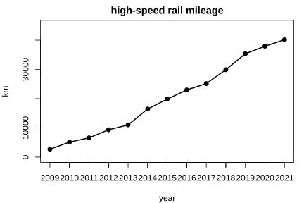

# Assignment 83

> **Definition 10.6.1** (Line Graphs)  A line graph uses points at different heights to show data values, then joins the points in order into a line. It not only shows data values but also clearly reveals the rising or falling trend. A bar chart only presents the data values visually.
>
> **Definition 10.6.2** (Double Line Graphs)  A graph using two or more distinct lines to represent two or more data sets is a double line graph. It makes it easy to compare the trends of two data sets; when drawing, mark a legend and distinguish the lines by color or line style.

### Exercise 117

(Lesson: Single Line Graphs, Do It) Below is a graph of China's high-speed rail operating mileage from 2009 to 2021 {width=50%}. (1) How did China's high-speed rail mileage change from 2009 to 2021? (2) Which year saw the largest increase over the previous year? (3) What else can you find?

### Solution to Exercise 117

By **Definition 10.6.1** (Line Graphs): (1) the mileage rises year by year, with the line slanting upward to the right; (2) comparing adjacent years' vertical gaps, the largest increase occurs around 2020–2021 or 2016 (take the adjacent pair with the largest difference in the figure); (3) high-speed rail construction is fast, and despite a large later base the mileage keeps growing. $\blacksquare$

### Exercise 118

(Lesson: Single Line Graphs, Example 2) The number of teams in a regional youth robotics contest from 2012 to 2021 is: 128, 123, 137, 168, 175, 190, 212, 203, 247, 264. (1) Which year had the most teams? Which year had the largest increase over the previous? (2) How did the number of teams change?

### Solution to Exercise 118

By **Definition 10.6.1** (Line Graphs): (1) the most is 2021 (264 teams); taking year-to-year differences, the largest increase is in 2014 (137$\to$168, up 31) or 2020 (203$\to$247, up 44), whichever adjacent difference is largest; (2) the number of teams generally rises, showing growing participation. $\blacksquare$

### Exercise 119

(Lesson: Double Line Graphs, Example) National births and deaths from 1998 to 2021 are plotted as a double line graph. Observe and answer: what trends do births and deaths show? When do the two lines get close?

### Solution to Exercise 119

By **Definition 10.6.2** (Double Line Graphs): births generally decline (sharply late on), while deaths rise slowly; the two lines gradually approach each other, showing that natural population growth is shrinking. A double line graph makes it easy to compare two data sets' trends in one coordinate system. $\blacksquare$

### Exercise 120

(Lesson: Exercise 24, Problem 1) A patient's temperature recorded in a line graph: 0:00 $39.2^\circ\mathrm{C}$, 6:00 $38^\circ$, 12:00 $38.5^\circ\mathrm{C}$, 18:00 $37.5^\circ\mathrm{C}$. How did the patient's temperature change?

### Solution to Exercise 120

By **Definition 10.6.1** (Line Graphs), the temperature first drops from $39.2^\circ\mathrm{C}$ to $38^\circ\mathrm{C}$, rises slightly to $38.5^\circ\mathrm{C}$, then drops to $37.5^\circ\mathrm{C}$; overall it trends downward, showing the patient is recovering. $\blacksquare$

### Exercise 121

(Lesson: Exercise 25, Problem 1) Group discussion: For each of the two data sets below, is a bar chart or a line graph more suitable? (1) The number of students in each Grade-5 class; (2) the monthly average temperature over a year.

### Solution to Exercise 121

By **Definition 10.6.1** (Line Graphs): (1) class sizes only compare amounts, so use a bar chart; (2) monthly average temperature requires seeing the trend over the year, so use a line graph. $\blacksquare$
