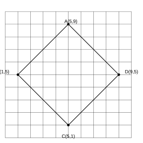
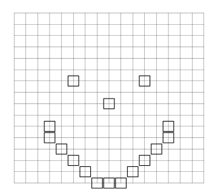
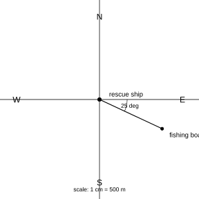

# Assignment 89

> **Definition 11.1.1** (Ordered Pairs)  Two numbers give a point's position in the plane; the first is the column, the second is the row, written $(a,b)$. Points in the same column share the first number; points in the same row share the second.
>
> **Definition 11.1.2** (Determining Position by Direction and Distance)  To fix an object's exact position in the plane, first choose a reference point, then know the object's direction and distance from it. Direction is usually described by an angle no more than $45^{\circ}$, e.g. "north by west $40^{\circ}$"; on a map, segment length represents actual distance at the given scale.

### Exercise 1

(Lesson: Determining Position by Ordered Pairs, Example 1) In the teacher's seating chart, Zhang Liang is in column $2$, row $3$, written as $(2,3)$. (1) What ordered pairs give Wang Yan's and Zhao Xue's positions? What's the difference? (2) $(6,3)$ is Wang Le's position; what column and row?

### Solution to Exercise 1

By **Definition 11.1.1** (Ordered Pairs), first number = column, second = row: Wang Yan is column $3$ row $4$, i.e. $(3,4)$; Zhao Xue is column $4$ row $3$, i.e. $(4,3)$. The two numbers are swapped. $(6,3)$ means column $6$, row $3$. $\blacksquare$

### Exercise 2

(Lesson: Ordered Pairs, Say It) If Zhou Ming is at $(1,3)$, can you give Zhang Liang, Sun Fang, Li Xiaodong, Wang Yan, Zhao Xue? Say: which classmates are at $(2,a)$? At $(b,3)$? ($a,b$ are nonzero integers.)

### Solution to Exercise 2

By **Definition 11.1.1** (Ordered Pairs): Zhang Liang $(2,3)$, Sun Fang $(2,2)$, Li Xiaodong $(2,1)$, Wang Yan $(3,4)$, Zhao Xue $(4,3)$. $(2,a)$ means classmates in column $2$ (Zhang Liang, Sun Fang, Li Xiaodong); $(b,3)$ means classmates in row $3$ (Zhou Ming, Zhang Liang, Zhao Xue). $\blacksquare$

### Exercise 3

(Lesson: Ordered Pairs, Do It Problem 1) Write the letters' positions as in the example: $A(5,9)$, $B(\;,\;)$, $C(\;,\;)$, $D(\;,\;)$.

{width=50%}

### Solution to Exercise 3

By **Definition 11.1.1** (Ordered Pairs), read each point's column and row: $A(5,9)$, $B(1,5)$, $C(5,1)$, $D(9,5)$. $\blacksquare$

### Exercise 4

(Lesson: Ordered Pairs, Do It Problem 2) Plot these points and join them in order to close the figure; what is it? $A(5,9)$, $B(1,6)$, $C(2,1)$, $D(8,1)$, $E(9,6)$.

### Solution to Exercise 4

On grid paper plot $A(5,9)$, $B(1,6)$, $C(2,1)$, $D(8,1)$, $E(9,6)$ in order, join and close back to $A$; you get a pentagon shaped like a small house roof. $\blacksquare$

### Exercise 5

(Lesson: Ordered Pairs, Exercise 1 Review Problem 1) Give real-life examples of using ordered pairs to fix a position.

### Solution to Exercise 5

E.g. cinema "row, seat", bookshelf "shelf level, book number", chess piece positions on a board, latitude/longitude on Earth — all use two numbers to fix a position. $\blacksquare$

### Exercise 6

(Lesson: Ordered Pairs, Exercise 1 Review Problem 2) On the seating chart find and color their seats, then write ordered pairs: Xiao Gang is row $8$, seat $10$; "I'm right in the row ahead of him, also seat $10$"; "I'm in the same row as him, seat $1$".

### Solution to Exercise 6

By **Definition 11.1.1** (Ordered Pairs): Xiao Gang $(10,8)$; row ahead same seat = $(10,7)$; same row seat $1$ = $(1,8)$. Color the corresponding cells. $\blacksquare$

### Exercise 7

(Lesson: Ordered Pairs, Exercise 1 Review Problem 3) The cell $(9,8)$ is already colored; continue coloring: points $(6,10)$, $(12,10)$, $(4,6)$, $(14,6)$, $(4,5)$, $(14,5)$, $(5,4)$, $(13,4)$, $(6,3)$, $(12,3)$, $(7,2)$, $(11,2)$, $(8,1)$, $(9,1)$, $(10,1)$.

{width=50%}

### Solution to Exercise 7

By **Definition 11.1.1** (Ordered Pairs), color each point by column-then-row; together they form a vertically symmetric pattern. $\blacksquare$

### Exercise 8

(Lesson: Ordered Pairs, Exercise 1 Integrated Problem 1) (1) Give triangle vertices $A$, $B$, $C$ as ordered pairs, then draw the triangle shifted right and up by $5$ units each. (2) Write the new vertices as ordered pairs; what do you notice?

### Solution to Exercise 8

By **Definition 11.1.1** (Ordered Pairs): shift right $5$ units, add $5$ to each first number and keep the second; shift up $5$ units, add $5$ to each second number and keep the first. Plot and join the new points. $\blacksquare$

### Exercise 9

(Lesson: Ordered Pairs, Exercise 1 Integrated Problem 2) A sorting robot delivers parcels: picks up at $(3,0)$, goes to $(3,1)$, then horizontally to $(7,1)$, then vertically to $(7,8)$, finally delivers at $(8,8)$. (1) From chute ③ to the Jiangxi delivery point, what other route? (2) To the Zhejiang delivery point? (3) With multiple robots delivering at once, how to avoid collisions?

### Solution to Exercise 9

The robot can only move horizontally or vertically. By **Definition 11.1.1** (Ordered Pairs), moving along a row changes the first number; moving along a column changes the second. (1) You may also go horizontal first then vertical, e.g. $(3,0)\to(8,0)\to(8,8)$, as long as the route avoids other chutes; (2) similarly go in horizontal/vertical segments to the Zhejiang point; (3) assign different robots different times or lanes so no two share a point at any moment. $\blacksquare$

### Exercise 10

(Lesson: Ordered Pairs, Exercise 1 Extension) On grid paper design a figure (vertices at grid intersections); describe each vertex to your deskmate and have them draw it.

### Solution to Exercise 10

Draw the figure, record each vertex's ordered pair, give only the coordinates; your deskmate plots and joins them by **Definition 11.1.1** (Ordered Pairs), and the result should match the original. $\blacksquare$

### Exercise 11

(Lesson: Direction and Distance, Example 2) A fishing boat is $1500\,\text{m}$ from the rescue ship. How to describe its position? The boat is on the east-by-south $25^{\circ}$ bearing (or south-by-east $65^{\circ}$). On the map $1\,\text{cm}$ represents $500\,\text{m}$, so $1500\,\text{m}$ is drawn as $3\,\text{cm}$.

{width=50%}

### Solution to Exercise 11

Distance alone doesn't fix position. By **Definition 11.1.2** (Determining Position by Direction and Distance): with the rescue ship as reference, the boat lies east-by-south $25^{\circ}$ at distance $1500\,\text{m}$. The two descriptions' angles sum to $90^{\circ}$; by convention use the angle no more than $45^{\circ}$, i.e. east-by-south $25^{\circ}$. $\blacksquare$

### Exercise 12

(Lesson: Direction and Distance, Do It Problem 1) Measure and state the direction from Beijing to Shenyang, Shanghai, Xi'an, Urumqi.

### Solution to Exercise 12

With Beijing as observer, use a protractor: Shenyang is east-by-south of Beijing, Shanghai south-by-east, Xi'an west-by-south, Urumqi west-by-north (angles per actual measurement). $\blacksquare$

### Exercise 13

(Lesson: Direction and Distance, Do It Problem 2) With People's Square as reference (scale $100\,\text{m}$ per segment): (1) City Hall is due west, distance $\_\_\,\text{m}$; (2) the Park is north-by-west $\_\_^{\circ}$, distance $\_\_\,\text{m}$; (3) the Workers' Cultural Palace is east-by-north $\_\_^{\circ}$; (4) the Tech Building is in the $\_\_$ direction; (5) the Bank is in the $\_\_$ direction.

### Solution to Exercise 13

By **Definition 11.1.2** (Determining Position by Direction and Distance): first measure angles, then measure map segment lengths and convert at $100\,\text{m}$ each. City Hall is due west $200\,\text{m}$; fill in the Park, Cultural Palace, Tech Building, Bank by measured angles and segment counts. $\blacksquare$

### Exercise 14

(Lesson: Direction and Distance, Do It Problem 3) Find a map of China and measure: Beijing lies $\_\_$ $\_\_$ of Harbin; Harbin lies $\_\_$ $\_\_$ of Beijing.

### Solution to Exercise 14

Swap the observer point and the directions reverse. Beijing is south-by-west of Harbin; Harbin is north-by-east of Beijing (angles per measurement). $\blacksquare$

### Exercise 15

(Lesson: Direction and Distance, Example 3) A cargo ship is north-by-west $40^{\circ}$ from the rescue ship, $1000\,\text{m}$ away. Mark its position on the map (scale: $1\,\text{cm}$ = $500\,\text{m}$).

### Solution to Exercise 15

By **Definition 11.1.2** (Determining Position by Direction and Distance): with the rescue ship as vertex, draw a ray north-by-west $40^{\circ}$; $1000\,\text{m}$ is $2\,\text{cm}$ on the map; the endpoint is the ship. $\blacksquare$

### Exercise 16

(Lesson: Direction and Distance, Do It Problem 1) On the map draw the west-by-north $30^{\circ}$, west-by-south $40^{\circ}$, and east-by-south $20^{\circ}$ directions from Island A.

### Solution to Exercise 16

With Island A as vertex, use a protractor to draw rays: due west tilted north $30^{\circ}$, due west tilted south $40^{\circ}$, due east tilted south $20^{\circ}$. $\blacksquare$

### Exercise 17

(Lesson: Direction and Distance, Example 4) On the campus map mark each building (scale $50\,\text{m}$ per segment): (1) the Teaching Building is due north of the gate, $150\,\text{m}$; (2) the Library is north-by-east $35^{\circ}$ of the gate, $150\,\text{m}$; (3) the Gym is west-by-north $40^{\circ}$ of the gate, $200\,\text{m}$.

### Solution to Exercise 17

By **Definition 11.1.2** (Determining Position by Direction and Distance), with the gate as reference: Teaching Building due north $3$ segments ($150\,\text{m}$); Library north-by-east $35^{\circ}$, $3$ segments; Gym west-by-north $40^{\circ}$, $4$ segments ($200\,\text{m}$). $\blacksquare$

### Exercise 18

(Lesson: Direction and Distance, Do It Problem 2) Measure: Xiao Gang's home lies $\_\_$ $\_\_$ of the school; the school lies $\_\_$ $\_\_$ of Xiao Gang's home; the distance is $\_\_\,\text{m}$ (scale $200\,\text{m}$ per segment). Describe the other students' homes similarly.

### Solution to Exercise 18

Swap observer point and directions reverse. With the school as observer measure Xiao Gang's home's direction and distance; from his home the school is the opposite direction, same distance. Describe Fangfang, Honghong, Liangliang similarly. $\blacksquare$

### Exercise 19

(Lesson: Direction and Distance, Example 5) Mingming's way home: from school go south-by-east $30^{\circ}$ for $200\,\text{m}$ to the Post Office; then from the Post Office to the Bookstore; then home. Describe the route by direction and distance.

### Solution to Exercise 19

Each leg uses its starting point as reference. By **Definition 11.1.2** (Determining Position by Direction and Distance): from school south-by-east $30^{\circ}$ $200\,\text{m}$ to Post Office; from Post Office at the drawn angle and distance to Bookstore; then from Bookstore to home. On the way back directions reverse and distances stay the same. $\blacksquare$

### Exercise 20

(Lesson: Direction and Distance, Do It Problem 3) Draw the route from a partner's description: "I go due south $50\,\text{m}$ to the corner, then south-by-west $30^{\circ}$ $100\,\text{m}$ to the park."

### Solution to Exercise 20

Mark the start, draw due south $50\,\text{m}$ to the corner; then with the corner as vertex draw south-by-west $30^{\circ}$ $100\,\text{m}$ to the park, marking the angle and distance. $\blacksquare$

### Exercise 21

(Lesson: Direction and Distance, Exercise 2 Review Problem 1) A Chinese-medicine cabinet grid. (1) Write Maidong, Danggui, Wuweizi as ordered pairs. (2) Sanqi is at $(8,6)$; mark it. (3) What other math questions can you ask?

### Solution to Exercise 21

By **Definition 11.1.1** (Ordered Pairs), read each herb's column and row from the grid and write (column, row); mark Sanqi at column $8$, row $6$; e.g. ask "which column and row is a certain herb?" and answer. $\blacksquare$

### Exercise 22

(Lesson: Direction and Distance, Exercise 2 Review Problem 2) The Teaching Building is $(2,5)$. (1) Write the Gym, Library, Canteen as ordered pairs. (2) Mark the Flower Bed $(6,5)$, Lab $(4,1)$, Small Playground $(8,6)$, Basketball Court $(7,4)$.

### Solution to Exercise 22

By **Definition 11.1.1** (Ordered Pairs): set the coordinate system from the Teaching Building $(2,5)$ and read (column, row) of Gym, Library, Canteen; then plot the four new spots. $\blacksquare$

### Exercise 23

(Lesson: Direction and Distance, Exercise 2 Review Problem 3) A directions map (scale $200\,\text{m}$ per segment): (1) the school is north-by-$\_\_$ of Mingming's home, distance $\_\_\,\text{m}$; (2) the Bookstore is $\_\_$ of his home; (3) the Post Office is $\_\_$; (4) the Swimming Pool is $\_\_$ of the Post Office.

### Solution to Exercise 23

By **Definition 11.1.2** (Determining Position by Direction and Distance), with Mingming's home as observer measure angles and distances: school north-by-east $30^{\circ}$, about $400\,\text{m}$; Bookstore and Post Office per drawn angles and segments; Swimming Pool described from the Post Office. $\blacksquare$

### Exercise 24

(Lesson: Direction and Distance, Exercise 2 Review Problem 4) Mark each location on the map with the TV Tower as center (scale $500\,\text{m}$ per segment): (1) Cultural Square is north-by-east $45^{\circ}$ of the tower, $1\,\text{km}$; (2) the Stadium is west-by-south $30^{\circ}$, $2.5\,\text{km}$; (3) the tower is east-by-south $20^{\circ}$ of the Museum, $2\,\text{km}$; (4) the tower is west-by-north $40^{\circ}$ of the Zoo, $1.5\,\text{km}$.

### Solution to Exercise 24

By **Definition 11.1.2** (Determining Position by Direction and Distance): with the TV Tower as center, mark Cultural Square and Stadium by angle and $2, 5, 4, 3$ segments; for (3)(4), use the tower as observer and go the opposite direction to fix Museum and Zoo. $\blacksquare$

### Exercise 25

(Lesson: Direction and Distance, Exercise 2 Review Problem 5) An oil exploration team drills a well east-by-north $40^{\circ}$ of Town A, $45\,\text{km}$ away. Fix the well on the map (scale $15\,\text{km}$ per segment).

### Solution to Exercise 25

By **Definition 11.1.2** (Determining Position by Direction and Distance), with Town A as vertex draw the east-by-north $40^{\circ}$ ray, mark $3$ segments ($45\,\text{km}$); the endpoint is the well. $\blacksquare$

### Exercise 26

(Lesson: Direction and Distance, Exercise 2 Integrated Problem 1) Take turns describing your route to and from school. E.g. "In the morning I walk due east about $200\,\text{m}$, then $\cdots\cdots$".

### Solution to Exercise 26

Split the route into legs, each with a clear reference point, direction, and distance. On the way back directions reverse and distances stay the same. $\blacksquare$

### Exercise 27

(Lesson: Direction and Distance, Exercise 2 Integrated Problem 2) The Library is at $(4,3)$, i.e. $400\,\text{m}$ east of school and $300\,\text{m}$ north (scale $100\,\text{m}$ per segment). (1) Describe the Mall, Post Office, Gym, Children's Palace, Park, Hospital similarly. (2) Wang Ling's home is $300\,\text{m}$ east and $400\,\text{m}$ north of school; Zhao Hua's home is $800\,\text{m}$ east and $700\,\text{m}$ north; mark them. (3) Wang Ling's route $(3,4)\to(4,3)\to(6,5)\to(3,6)\to(3,4)$ — where did she go?

### Solution to Exercise 27

By **Definition 11.1.1** (Ordered Pairs): (1) read each spot's coordinates and convert to "east _ hundred meters, north _ hundred meters"; (2) Wang Ling's home $(3,4)$, Zhao Hua's $(8,7)$; (3) $(4,3)$ is the Library; $(6,5)$, $(3,6)$ match spots on the map in order; finally back to $(3,4)$ = home. $\blacksquare$

### Exercise 28

(Lesson: Direction and Distance, Exercise 2 Integrated Problem 3) If each small square's diagonal is $10\,\text{m}$, then: point $(0,0)$ east-by-north $45^{\circ}$ $30\,\text{m}$ away is point $(\;,\;)$; point $(4,2)$ south-by-west $45^{\circ}$ $20\,\text{m}$ away is $(\;,\;)$; point $(6,7)$ north-by-east $45^{\circ}$ $10\,\text{m}$ away is $(\;,\;)$; point $(4,4)$ west-by-north $45^{\circ}$ $40\,\text{m}$ away is $(\;,\;)$.

### Solution to Exercise 28

Walking one diagonal changes column and row by the same number of cells. $30\,\text{m}$ = $3$ diagonals: $(0,0)$ east-by-north $45^{\circ}$ → $(3,3)$; $(4,2)$ south-by-west $45^{\circ}$ $20\,\text{m}$ → $(2,0)$; $(6,7)$ north-by-east $45^{\circ}$ $10\,\text{m}$ → $(7,8)$; $(4,4)$ west-by-north $45^{\circ}$ $40\,\text{m}$ → $(0,8)$. $\blacksquare$

### Exercise 29

(Lesson: Direction and Distance, Exercise 2 Integrated Problem 4) Xiaoling's route: Home $\to$ Mall ($15$ min), Mall $\to$ Bookstore ($7$ min), Bookstore $\to$ Mall ($8$ min), Mall $\to$ Home ($18$ min); scale $200\,\text{m}$ per segment. (1) Complete the direction-distance table. (2) Her average speed for the whole trip?

### Solution to Exercise 29

By **Definition 11.1.2** (Determining Position by Direction and Distance): fill the table by the drawn $30^{\circ}$ angle and segment counts; sum leg distances for the total; total time $15+7+8+18=48$ min, average speed $=$ total $\div 48$ min. $\blacksquare$

### Exercise 30

(Lesson: Direction and Distance, Exercise 2 Extension Problem 1) Route 1 bus: from the start go west-by-north $40^{\circ}$ for $3\,\text{km}$, then due west $4\,\text{km}$, then south-by-west $30^{\circ}$ for $3\,\text{km}$ to the terminus (scale $1\,\text{km}$ per segment). (1) Complete the route map. (2) On the return, what directions and distances?

### Solution to Exercise 30

By **Definition 11.1.2** (Determining Position by Direction and Distance): draw the three legs from the start; on return each leg's direction reverses (east-by-south $40^{\circ}$, due east, north-by-east $30^{\circ}$), distances still $3, 4, 3\,\text{km}$. $\blacksquare$

### Exercise 31

(Lesson: Direction and Distance, Exercise 2 Extension Problem 2) Design a "mini zoo" guide map: draw a sketch, describe each enclosure, then design a tour route and describe how to walk it.

### Solution to Exercise 31

Choose the gate as reference; describe each enclosure by **Definition 11.1.1** (Ordered Pairs) or **Definition 11.1.2** (Determining Position by Direction and Distance); split the tour into legs with clear direction and distance; avoid repeating ground. $\blacksquare$
