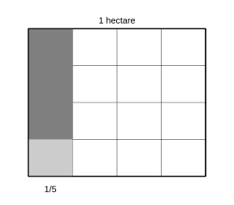

# Assignment 90

> **Definition 11.2.1** (Fraction Times an Integer)  To multiply a fraction by an integer, multiply the numerator by the integer and keep the denominator. Reduce first when possible. E.g. $\frac{3}{8}\times2=\frac{3\times2}{8}=\frac{3}{4}$.
>
> **Definition 11.2.2** (A Number Times a Fraction)  To multiply by a fraction, multiply numerators for the new numerator and denominators for the new denominator: $\frac{b}{a}\times\frac{d}{c}=\frac{bd}{ac}$ ($a,c\neq0$). An integer is a fraction over $1$. To find a fraction of a number, multiply.
>
> **Definition 11.2.3** (Mixed Operations and Laws for Fractions)  The order of mixed fraction operations is the same as for integers; the commutative, associative, and distributive laws of integer multiplication also hold, and applying them sometimes simplifies the work.
>
> **Definition 11.2.4** (Successive Fraction-of-a-Number)  To repeatedly take a fraction of a number, multiply in sequence; or first multiply the two fractions to get the fraction of the whole, then multiply by the whole.

### Exercise 32

(Lesson: Fraction Times an Integer, Example 1) An eco-club makes paper flowers from recycled wrapping paper; each flower uses $\frac{3}{8}$ sheet. (1) How many sheets for $2$ flowers? (2) How many sheets for $8$ flowers?

### Solution to Exercise 32

By **Definition 11.2.1** (Fraction Times an Integer): (1) $\frac{3}{8}\times2=\frac{3\times2}{8}=\frac{6}{8}=\frac{3}{4}$ sheet; (2) $\frac{3}{8}\times8=3$ sheets. $\blacksquare$

### Exercise 33

(Lesson: Fraction Times an Integer, Do It) A bag of bread weighs $\frac{3}{10}\,\text{kg}$; how much do $3$ bags weigh?

### Solution to Exercise 33

By **Definition 11.2.1** (Fraction Times an Integer): $\frac{3}{10}\times3=\frac{9}{10}\,\text{kg}$. $\blacksquare$

### Exercise 34

(Lesson: A Number Times a Fraction, Example 2) (1) A nursery plot of $2$ hectares uses $\frac{5}{8}$ for willow saplings. How many hectares of willow? (2) A nursery plot of $\frac{4}{5}$ hectares uses $\frac{2}{3}$ for ginkgo saplings. How many hectares of ginkgo?

### Solution to Exercise 34

By **Definition 11.2.2** (A Number Times a Fraction): (1) $2\times\frac{5}{8}=\frac{2\times5}{8}=\frac{5}{4}$ hectares; (2) $\frac{4}{5}\times\frac{2}{3}=\frac{4\times2}{5\times3}=\frac{8}{15}$ hectares. $\blacksquare$

### Exercise 35

(Lesson: A Number Times a Fraction, Do It Problem 1) Compute from the figures: $\frac{1}{2}\times\frac{1}{2}$; $\frac{2}{3}\times\frac{4}{5}$; $\frac{3}{4}\times\frac{3}{4}$.

### Solution to Exercise 35

By **Definition 11.2.2** (A Number Times a Fraction): $\frac{1}{2}\times\frac{1}{2}=\frac{1}{4}$; $\frac{2}{3}\times\frac{4}{5}=\frac{8}{15}$; $\frac{3}{4}\times\frac{3}{4}=\frac{9}{16}$. $\blacksquare$

### Exercise 36

(Lesson: A Number Times a Fraction, Do It Problem 2) Compute: $\frac{4}{7}\times\frac{1}{4}$; $\frac{20}{9}\times\frac{3}{10}$; $6\times\frac{11}{12}$; $\frac{5}{4}\times10$.

### Solution to Exercise 36

By **Definition 11.2.2** (A Number Times a Fraction): $\frac{4}{7}\times\frac{1}{4}=\frac{1}{7}$; $\frac{20}{9}\times\frac{3}{10}=\frac{2}{3}$; $6\times\frac{11}{12}=\frac{11}{2}$; $\frac{5}{4}\times10=\frac{25}{2}$. $\blacksquare$

### Exercise 37

(Lesson: A Number Times a Fraction, Exercise 3 Review Problem 1) This plot is $1$ hectare; first shade $\frac{1}{5}$ hectare, then shade $\frac{3}{4}$ of $\frac{1}{5}$ hectare. How many hectares are shaded? Write $\left(\;\right)\times\left(\;\right)$.

{width=50%}

### Solution to Exercise 37

By **Definition 11.2.4** (Successive Fraction-of-a-Number): $\frac{1}{5}\times\frac{3}{4}=\frac{3}{20}$ hectare. $\blacksquare$

### Exercise 38

(Lesson: A Number Times a Fraction, Exercise 3 Review Problem 2) Compute; what do you notice? $\frac{2}{9}\times3$; $\frac{2}{9}\times\frac{1}{2}$; $\frac{2}{9}\times\frac{3}{4}$; $\frac{6}{5}\times\frac{5}{3}$; $\frac{6}{5}\times\frac{1}{2}$; $\frac{6}{5}\times\frac{2}{3}$.

### Solution to Exercise 38

$\frac{2}{9}\times3=\frac{2}{3}$; $\frac{2}{9}\times\frac{1}{2}=\frac{1}{9}$; $\frac{2}{9}\times\frac{3}{4}=\frac{1}{6}$; $\frac{6}{5}\times\frac{5}{3}=2$; $\frac{6}{5}\times\frac{1}{2}=\frac{3}{5}$; $\frac{6}{5}\times\frac{2}{3}=\frac{4}{5}$. Multiplying by a number less than $1$ gives a smaller product. $\blacksquare$

### Exercise 39

(Lesson: A Number Times a Fraction, Exercise 3 Review Problem 3) Are these right? Correct the wrong ones: $4\times\frac{4}{7}=\frac{4\times4}{7}=\frac{1}{7}$; $\frac{7}{10}\times\frac{6}{5}=\frac{7}{10}\times\frac{6}{5}=\frac{10}{10}=1$.

### Solution to Exercise 39

Both wrong. By **Definition 11.2.1** (Fraction Times an Integer) and **Definition 11.2.2** (A Number Times a Fraction): $4\times\frac{4}{7}=\frac{16}{7}$; $\frac{7}{10}\times\frac{6}{5}=\frac{42}{50}=\frac{21}{25}$. $\blacksquare$

### Exercise 40

(Lesson: A Number Times a Fraction, Exercise 3 Review Problem 4) A wall is $20\,\text{m}^2$; $\frac{1}{4}$ of it has been painted. How many square meters are painted?

### Solution to Exercise 40

By **Definition 11.2.2** (A Number Times a Fraction): $20\times\frac{1}{4}=5\,\text{m}^2$. $\blacksquare$

### Exercise 41

(Lesson: A Number Times a Fraction, Exercise 3 Review Problem 5) (1) What is $\frac{3}{5}$ of $\frac{1}{4}\,\text{t}$? (2) What is $\frac{3}{4}$ of $\frac{3}{8}\,\text{m}$?

### Solution to Exercise 41

By **Definition 11.2.2** (A Number Times a Fraction): (1) $\frac{1}{4}\times\frac{3}{5}=\frac{3}{20}\,\text{t}$; (2) $\frac{3}{8}\times\frac{3}{4}=\frac{9}{32}\,\text{m}$. $\blacksquare$

### Exercise 42

(Lesson: A Number Times a Fraction, Exercise 3 Review Problem 6) The Forbidden City covers about $72$ ten-thousand square meters, of which built-up area is $\frac{5}{24}$. About how many ten-thousand square meters of built-up area?

### Solution to Exercise 42

By **Definition 11.2.2** (A Number Times a Fraction): $72\times\frac{5}{24}=15$ ten-thousand square meters. $\blacksquare$

### Exercise 43

(Lesson: A Number Times a Fraction, Exercise 3 Review Problem 7) Worldwide $15$ crane species are known; China has the most, $\frac{3}{5}$ of the world total. How many crane species in China?

### Solution to Exercise 43

By **Definition 11.2.2** (A Number Times a Fraction): $15\times\frac{3}{5}=9$ species. $\blacksquare$

### Exercise 44

(Lesson: A Number Times a Fraction, Exercise 3 Review Problem 8) Altair's average speed is about $26$ km/s; Vega's is $\frac{7}{13}$ of Altair's. About how many km/s for Vega?

### Solution to Exercise 44

By **Definition 11.2.2** (A Number Times a Fraction): $26\times\frac{7}{13}=14$ km/s. $\blacksquare$

### Exercise 45

(Lesson: A Number Times a Fraction, Exercise 3 Review Problem 9) In 2021, the number of good air-quality days in a city was $\frac{58}{73}$ of the year ($365$ days). How many good days?

### Solution to Exercise 45

By **Definition 11.2.2** (A Number Times a Fraction): $365\times\frac{58}{73}=5\times58=290$ days. $\blacksquare$

### Exercise 46

(Lesson: A Number Times a Fraction, Exercise 3 Integrated Problem 10) Recycled waste paper yields recycled paper equal to $\frac{4}{5}$ of its weight. (1) Aunt Li sorts $80\,\text{kg}$ of old newspaper; how much recycled paper? (2) 2022 national paper and paperboard consumption was about $12403$ ten-thousand tons, of which $\frac{2}{5}$ is recyclable; about how many ten-thousand tons?

### Solution to Exercise 46

By **Definition 11.2.2** (A Number Times a Fraction): (1) $80\times\frac{4}{5}=64\,\text{kg}$; (2) $12403\times\frac{2}{5}=4961.2$ ten-thousand tons. $\blacksquare$

### Exercise 47

(Lesson: A Number Times a Fraction, Exercise 3 Integrated Problem 11) A child's backpack should weigh no more than $\frac{3}{20}$ of body weight. Li Ming weighs $40\,\text{kg}$ and his bag is $5\,\text{kg}$. (1) Is his bag overweight? Why? (2) Weigh yourself; compute your safe load.

### Solution to Exercise 47

By **Definition 11.2.2** (A Number Times a Fraction): safe load $40\times\frac{3}{20}=6\,\text{kg}$. The bag $5\,\text{kg}<6\,\text{kg}$, so not overweight. (2) Multiply your own weight by $\frac{3}{20}$. $\blacksquare$

### Exercise 48

(Lesson: A Number Times a Fraction, Exercise 3 Extension Problem 12) Use $1$, $4$, $5$ to make two mixed numbers (each uses all $3$ digits) so that: $\square\frac{\square}{\square}\times\frac{3}{7}=\square\frac{\square}{\square}$.

### Solution to Exercise 48

Try: $1\frac{4}{5}\times\frac{3}{7}=\frac{9}{5}\times\frac{3}{7}=\frac{27}{35}$, not a mixed number. Adjust: $4\frac{1}{5}\times\frac{3}{7}=\frac{21}{5}\times\frac{3}{7}=\frac{9}{5}=1\frac{4}{5}$. So $4\frac{1}{5}\times\frac{3}{7}=1\frac{4}{5}$. $\blacksquare$

### Exercise 49

(Lesson: Mixed Fraction-Decimal Operations and Laws, Example 3) A squirrel's tail is about $\frac{3}{4}$ of its body length. Huanhuan's body is $2.1\,\text{dm}$; Lele's is $2.4\,\text{dm}$. (1) Huanhuan's tail? (2) Lele's tail?

### Solution to Exercise 49

By **Definition 11.2.2** (A Number Times a Fraction): (1) $2.1\times\frac{3}{4}=\frac{21}{10}\times\frac{3}{4}=\frac{63}{40}=1.575\,\text{dm}$; (2) $2.4\times\frac{3}{4}=1.8\,\text{dm}$ (reduce first). $\blacksquare$

### Exercise 50

(Lesson: Mixed Fraction-Decimal Operations, Do It Problem 1) Compute: $1.2\times\frac{3}{5}$; $2.5\times\frac{3}{5}$; $1.4\times\frac{5}{6}$; $2.4\times\frac{5}{6}$.

### Solution to Exercise 50

$1.2\times\frac{3}{5}=0.72$; $2.5\times\frac{3}{5}=1.5$; $1.4\times\frac{5}{6}=\frac{7}{6}\approx1.17$; $2.4\times\frac{5}{6}=2$. $\blacksquare$

### Exercise 51

(Lesson: Mixed Fraction-Decimal Operations, Do It Problem 2) A hummingbird flies at $0.8$ km/min; how far in $\frac{3}{4}$ min? In $5$ min?

### Solution to Exercise 51

By **Definition 11.2.2** (A Number Times a Fraction): $0.8\times\frac{3}{4}=0.6$ km; $0.8\times5=4$ km. $\blacksquare$

### Exercise 52

(Lesson: Mixed Fraction-Decimal Operations, Do It Problem 3) 2021 China's GDP per capita was about $8.1$ ten-thousand yuan. 2020 was about $\frac{8}{9}$ of 2021. About how much per capita in 2020?

### Solution to Exercise 52

By **Definition 11.2.2** (A Number Times a Fraction): $8.1\times\frac{8}{9}=7.2$ ten-thousand yuan. $\blacksquare$

### Exercise 53

(Lesson: Mixed Fraction-Decimal Operations, Do It Problem 4) In a honey, fructose and glucose total $\frac{4}{5}$ of the honey's mass. With $2.5\,\text{kg}$ of this honey, how many kg are fructose and glucose together?

### Solution to Exercise 53

By **Definition 11.2.2** (A Number Times a Fraction): $2.5\times\frac{4}{5}=2\,\text{kg}$. $\blacksquare$

### Exercise 54

(Lesson: Mixed Fraction-Decimal Operations, Think) Mixed fraction operations follow the same order as integers. Can you compute $\left(\frac{4}{5}+\frac{1}{2}\right)\times2$ and $\frac{4}{5}\times2+\frac{1}{2}\times2$? Are the two equal?

### Solution to Exercise 54

By **Definition 11.2.3** (Mixed Operations and Laws for Fractions): $\left(\frac{4}{5}+\frac{1}{2}\right)\times2=\frac{13}{10}\times2=\frac{13}{5}$; $\frac{4}{5}\times2+\frac{1}{2}\times2=\frac{8}{5}+1=\frac{13}{5}$. Equal — the distributive law. $\blacksquare$

### Exercise 55

(Lesson: Mixed Fraction-Decimal Operations, Example 4) Simplify: $\frac{3}{5}\times\left(\frac{1}{6}\times5\right)$; $\left(\frac{5}{6}+\frac{1}{4}\right)\times12$; product $\frac{2}{3}\times\frac{8}{7}\times14\times\frac{9}{4}$.

### Solution to Exercise 55

By **Definition 11.2.3** (Mixed Operations and Laws for Fractions): $\frac{3}{5}\times\left(\frac{1}{6}\times5\right)=\frac{3}{5}\times\left(5\times\frac{1}{6}\right)=3\times\frac{1}{6}=\frac{1}{2}$ (commutative); $\left(\frac{5}{6}+\frac{1}{4}\right)\times12=\frac{5}{6}\times12+\frac{1}{4}\times12=10+3=13$ (distributive); the product reduces to $24$. $\blacksquare$

### Exercise 56

(Lesson: Mixed Fraction-Decimal Operations, Do It Problem 1) Simplify and say which law: $\frac{2}{3}\times\frac{1}{7}\times3$; $\left(\frac{8}{9}+\frac{4}{27}\right)\times27$; $87\times\frac{3}{86}$.

### Solution to Exercise 56

By **Definition 11.2.3** (Mixed Operations and Laws for Fractions): $\frac{2}{3}\times3\times\frac{1}{7}=\frac{2}{7}$ (commutative); $\frac{8}{9}\times27+\frac{4}{27}\times27=24+4=28$ (distributive); $87\times\frac{3}{86}=\left(86+1\right)\times\frac{3}{86}=3+\frac{3}{86}=3\frac{3}{86}$ (distributive). $\blacksquare$

### Exercise 57

(Lesson: Mixed Fraction-Decimal Operations, Do It Problem 2) A dairy cow averages $\frac{1}{50}\,\text{t}$ of milk per day; how many tons do $42$ cows give in $100$ days?

### Solution to Exercise 57

By **Definition 11.2.3** (Mixed Operations and Laws for Fractions): $\frac{1}{50}\times42\times100=84\,\text{t}$. $\blacksquare$

### Exercise 58

(Lesson: Mixed Fraction-Decimal Operations, Exercise 4 Review Problem 1) Compute: $\frac{27}{50}\times2$; $\frac{11}{28}\times\frac{8}{33}$; $\frac{20}{39}\times7.8$; $\frac{7}{18}\times0.36$; $\frac{9}{16}\times0.3$; $\frac{5}{54}\times6.75$.

### Solution to Exercise 58

$\frac{27}{50}\times2=\frac{27}{25}$; $\frac{11}{28}\times\frac{8}{33}=\frac{2}{21}$; $\frac{20}{39}\times7.8=4$; $\frac{7}{18}\times0.36=0.14$; $\frac{9}{16}\times0.3=\frac{27}{160}$; $\frac{5}{54}\times6.75=0.625$. $\blacksquare$

### Exercise 59

(Lesson: Mixed Fraction-Decimal Operations, Exercise 4 Review Problem 2) An ostrich is $2.5\,\text{m}$ tall; an adult emperor penguin is $\frac{12}{25}$ of that. How tall is the penguin?

### Solution to Exercise 59

By **Definition 11.2.2** (A Number Times a Fraction): $2.5\times\frac{12}{25}=1.2\,\text{m}$. $\blacksquare$

### Exercise 60

(Lesson: Mixed Fraction-Decimal Operations, Exercise 4 Review Problem 3) Compute: $\frac{1}{3}\times\frac{3}{5}+1$; $\frac{5}{7}-\frac{5}{9}\times\frac{5}{7}$; $1-\frac{15}{28}\times\frac{21}{25}$; $\frac{1}{2}+\frac{5}{4}\times\frac{4}{5}$; $\frac{1}{6}\times\left(5-\frac{2}{3}\right)$; $\frac{7}{8}\times7+\frac{3}{8}$.

### Solution to Exercise 60

$\frac{1}{3}\times\frac{3}{5}+1=\frac{1}{5}+1=\frac{6}{5}$; $\frac{5}{7}-\frac{5}{9}\times\frac{5}{7}=\frac{5}{7}\times\left(1-\frac{5}{9}\right)=\frac{20}{63}$; $1-\frac{15}{28}\times\frac{21}{25}=1-\frac{9}{20}=\frac{11}{20}$; $\frac{1}{2}+\frac{5}{4}\times\frac{4}{5}=\frac{1}{2}+1=\frac{3}{2}$; $\frac{1}{6}\times\left(5-\frac{2}{3}\right)=\frac{1}{6}\times\frac{13}{3}=\frac{13}{18}$; $\frac{7}{8}\times7+\frac{3}{8}=\frac{49}{8}+\frac{3}{8}=\frac{13}{2}$. $\blacksquare$

### Exercise 61

(Lesson: Mixed Fraction-Decimal Operations, Exercise 4 Review Problem 4) Are these right? Correct: $5-3\times\frac{7}{9}=2\times\frac{7}{9}=\frac{14}{9}$; $\left(\frac{1}{6}+\frac{3}{4}\right)\times6=1+\frac{3}{4}=\frac{7}{4}$.

### Solution to Exercise 61

Both wrong. By **Definition 11.2.3** (Mixed Operations and Laws for Fractions), multiply before subtracting: $5-3\times\frac{7}{9}=5-\frac{7}{3}=\frac{8}{3}$; the distributive law missed a term: $\left(\frac{1}{6}+\frac{3}{4}\right)\times6=\frac{1}{6}\times6+\frac{3}{4}\times6=1+\frac{9}{2}=\frac{11}{2}$. $\blacksquare$

### Exercise 62

(Lesson: Mixed Fraction-Decimal Operations, Exercise 4 Review Problem 5) Simplify by the laws: $\frac{2}{9}-\frac{7}{16}\times\frac{2}{9}$; $\frac{2}{27}\times4\times\frac{3}{4}$; $\frac{5}{7}\times16\times\frac{42}{25}$; $\frac{1}{2}\times\frac{1}{15}+\frac{1}{3}\times\frac{1}{2}$; $\frac{4}{5}\times\frac{7}{9}\times\frac{15}{8}$; $\frac{5}{6}\times\frac{5}{9}+\frac{5}{9}\times\frac{1}{6}$.

### Solution to Exercise 62

By **Definition 11.2.3** (Mixed Operations and Laws for Fractions): $\frac{2}{9}\times\left(1-\frac{7}{16}\right)=\frac{2}{9}\times\frac{9}{16}=\frac{1}{8}$; $\frac{2}{27}\times\left(4\times\frac{3}{4}\right)=\frac{2}{27}\times3=\frac{2}{9}$; $\frac{5}{7}\times16\times\frac{42}{25}=\frac{96}{5}$; $\frac{1}{2}\times\left(\frac{1}{15}+\frac{1}{3}\right)=\frac{1}{2}\times\frac{6}{15}=\frac{1}{5}$; $\frac{4}{5}\times\frac{7}{9}\times\frac{15}{8}=\frac{7}{6}$; $\frac{5}{9}\times\left(\frac{5}{6}+\frac{1}{6}\right)=\frac{5}{9}$. $\blacksquare$

### Exercise 63

(Lesson: Mixed Fraction-Decimal Operations, Exercise 4 Review Problem 6) Simplify where possible: $\frac{11}{24}\times16$; $\frac{1}{4}\times\frac{2}{7}$; $\frac{7}{12}\times6+\frac{17}{12}\times6$; $\frac{3}{5}\times\frac{55}{6}$; $\frac{4}{9}\times5\times18$; $\left(14+\frac{7}{2}\right)\times\frac{1}{14}$.

### Solution to Exercise 63

$\frac{11}{24}\times16=\frac{22}{3}$; $\frac{1}{4}\times\frac{2}{7}=\frac{1}{14}$; $\left(\frac{7}{12}+\frac{17}{12}\right)\times6=2\times6=12$; $\frac{3}{5}\times\frac{55}{6}=\frac{11}{2}$; $\frac{4}{9}\times18\times5=40$; $14\times\frac{1}{14}+\frac{7}{2}\times\frac{1}{14}=1+\frac{1}{4}=\frac{5}{4}$. $\blacksquare$

### Exercise 64

(Lesson: Mixed Fraction-Decimal Operations, Exercise 4 Integrated Problem 7) Find the areas (unit: dm): a right triangle with legs $\frac{3}{4}$, $\frac{4}{9}$; a trapezoid with upper base $\frac{11}{18}$, lower base $\frac{8}{9}$, height $\frac{2}{3}$.

### Solution to Exercise 64

Triangle area $=\frac{1}{2}\times\frac{3}{4}\times\frac{4}{9}=\frac{1}{6}\,\text{dm}^2$; trapezoid area $=\frac{1}{2}\times\left(\frac{11}{18}+\frac{8}{9}\right)\times\frac{2}{3}=\frac{1}{2}\times\frac{27}{18}\times\frac{2}{3}=\frac{1}{2}\,\text{dm}^2$. $\blacksquare$

### Exercise 65

(Lesson: Mixed Fraction-Decimal Operations, Exercise 4 Integrated Problem 8) Each paper flower uses $\frac{1}{4}$ sheet. Xiaoyu cuts $9$ flowers and Xiaoting cuts $11$. How many sheets total?

### Solution to Exercise 65

By **Definition 11.2.3** (Mixed Operations and Laws for Fractions): $\frac{1}{4}\times\left(9+11\right)=\frac{1}{4}\times20=5$ sheets. $\blacksquare$

### Exercise 66

(Lesson: Mixed Fraction-Decimal Operations, Exercise 4 Integrated Problem 9) A rectangular table is $\frac{5}{4}\,\text{m}$ by $\frac{3}{5}\,\text{m}$. A square table has area $\frac{9}{10}\,\text{m}^2$. By how many square meters is the rectangle smaller?

### Solution to Exercise 66

Rectangle area $\frac{5}{4}\times\frac{3}{5}=\frac{3}{4}\,\text{m}^2$; difference $\frac{9}{10}-\frac{3}{4}=\frac{18}{20}-\frac{15}{20}=\frac{3}{20}\,\text{m}^2$. $\blacksquare$

### Exercise 67

(Lesson: Mixed Fraction-Decimal Operations, Exercise 4 Integrated Problem 10) A solar plant averages $2400$ ten-thousand kWh per year; $\frac{1}{3}$ to households, $\frac{3}{8}$ to industry, $\frac{1}{6}$ to agriculture. How many ten-thousand kWh supplied in total?

### Solution to Exercise 67

By **Definition 11.2.3** (Mixed Operations and Laws for Fractions): $2400\times\left(\frac{1}{3}+\frac{3}{8}+\frac{1}{6}\right)=2400\times\frac{5}{8}=1500$ ten-thousand kWh. $\blacksquare$

### Exercise 68

(Lesson: Mixed Fraction-Decimal Operations, Exercise 4 Integrated Problem 11) The Nile is $6670\,\text{km}$ long; the Yangtze is about $297\,\text{km}$ longer than $\frac{9}{10}$ of the Nile. About how long is the Yangtze?

### Solution to Exercise 68

$6670\times\frac{9}{10}+297=6003+297=6300\,\text{km}$. $\blacksquare$

### Exercise 69

(Lesson: Mixed Fraction-Decimal Operations, Exercise 4 Extension Problem 12) Observe $\frac{9}{2}+\frac{9}{7}=\frac{9}{2}\times\frac{9}{7}$, $\frac{8}{3}+\frac{8}{5}=\frac{8}{3}\times\frac{8}{5}$; fill in: $\square+\frac{5}{2}=\square\times\frac{5}{2}$; $6+\square=6\times\square$.

### Solution to Exercise 69

Rule: two fractions with the same numerator equal to the sum of the denominators have sum equal to product. First pair denominators $2$ and $\square$, numerator $5$, i.e. $\frac{5}{3}+\frac{5}{2}=\frac{5}{3}\times\frac{5}{2}$. Second pair $6=\frac{6}{1}$, the other denominator is $5$: $6+\frac{6}{5}=6\times\frac{6}{5}$. $\blacksquare$

### Exercise 70

(Lesson: Mixed Fraction-Decimal Operations, Exercise 4 Extension Problem 13) Observe $\frac{1}{2}-\frac{1}{3}=\frac{1}{2}\times\frac{1}{3}$, $\frac{1}{3}-\frac{1}{4}=\frac{1}{3}\times\frac{1}{4}$, $\frac{1}{4}-\frac{1}{5}=\frac{1}{4}\times\frac{1}{5}$. What rule? Verify with another example.

### Solution to Exercise 70

Rule: two fractions with numerator $1$ and consecutive denominators have their difference equal to their product, i.e. $\frac{1}{n}-\frac{1}{n+1}=\frac{1}{n\left(n+1\right)}=\frac{1}{n}\times\frac{1}{n+1}$. E.g. $\frac{1}{5}-\frac{1}{6}=\frac{1}{30}=\frac{1}{5}\times\frac{1}{6}$. $\blacksquare$

### Exercise 71

(Lesson: Solving Problems, Example 5) A community leisure space is $4800\,\text{m}^2$. $\frac{3}{5}$ is made into a sports-fitness area, of which equipment area is $\frac{1}{4}$. How large is the equipment area?

### Solution to Exercise 71

By **Definition 11.2.4** (Successive Fraction-of-a-Number): $4800\times\frac{3}{5}\times\frac{1}{4}=2880\times\frac{1}{4}=720\,\text{m}^2$. Or $4800\times\left(\frac{3}{5}\times\frac{1}{4}\right)=4800\times\frac{3}{20}=720\,\text{m}^2$. $\blacksquare$

### Exercise 72

(Lesson: Solving Problems, Do It Problem 1) Class 6(1) has $36$ students; $\frac{1}{3}$ want to be teachers, and those who want to be scientists are $\frac{3}{4}$ of the teacher-wishers. How many want to be scientists?

### Solution to Exercise 72

By **Definition 11.2.4** (Successive Fraction-of-a-Number): $36\times\frac{1}{3}\times\frac{3}{4}=12\times\frac{3}{4}=9$ students. $\blacksquare$

### Exercise 73

(Lesson: Solving Problems, Do It Problem 2) A walrus lives about $40$ years; a sea lion lives $\frac{3}{4}$ as long; a seal lives $\frac{2}{3}$ as long as a sea lion. About how long does a seal live?

### Solution to Exercise 73

By **Definition 11.2.4** (Successive Fraction-of-a-Number): $40\times\frac{3}{4}\times\frac{2}{3}=30\times\frac{2}{3}=20$ years. $\blacksquare$

### Exercise 74

(Lesson: Solving Problems, Example 6) Uncle Li's restaurant used to produce about $100\,\text{kg}$ of food waste per day; after the "Clean Plate" campaign, it dropped by about $\frac{1}{4}$. About how much food waste per day now?

### Solution to Exercise 74

By **Definition 11.2.2** (A Number Times a Fraction): first the reduction $100\times\frac{1}{4}=25\,\text{kg}$, then $100-25=75\,\text{kg}$; or take the remaining fraction $100\times\left(1-\frac{1}{4}\right)=100\times\frac{3}{4}=75\,\text{kg}$. $\blacksquare$

### Exercise 75

(Lesson: Solving Problems, Do It) A teen's heart beats about $75$ times per minute; a baby's is $\frac{4}{5}$ more. About how many beats per minute for a baby?

### Solution to Exercise 75

By **Definition 11.2.2** (A Number Times a Fraction): $75\times\left(1+\frac{4}{5}\right)=75\times\frac{9}{5}=135$ beats. $\blacksquare$

### Exercise 76

(Lesson: Solving Problems, Exercise 5 Review Problem 1) From the figure: (1) $120$ trees, willow and peach together are $\frac{5}{6}$; how many peach? (2) $160$ apples; peaches are $\frac{3}{4}$ of apples; oranges are $\frac{4}{5}$ of peaches; how many oranges?

### Solution to Exercise 76

(1) $120\times\frac{5}{6}=100$ trees, i.e. willow and peach together $100$; then use the figure's parts to find peach. (2) $160\times\frac{3}{4}\times\frac{4}{5}=96$. $\blacksquare$

### Exercise 77

(Lesson: Solving Problems, Exercise 5 Review Problem 2) Blood flows at about $20$ cm/s in the aorta, $\frac{2}{5}$ of that in veins, and only $\frac{1}{160}$ of veins in capillaries. About how many cm/s in capillaries?

### Solution to Exercise 77

By **Definition 11.2.4** (Successive Fraction-of-a-Number): $20\times\frac{2}{5}\times\frac{1}{160}=8\times\frac{1}{160}=\frac{1}{20}$ cm/s. $\blacksquare$

### Exercise 78

(Lesson: Solving Problems, Exercise 5 Review Problem 3) A peony flowers for $32$ days; a rose flowers $\frac{5}{8}$ as long; a narcissus flowers $\frac{3}{4}$ as long as a rose. How long does a narcissus flower?

### Solution to Exercise 78

By **Definition 11.2.4** (Successive Fraction-of-a-Number): $32\times\frac{5}{8}\times\frac{3}{4}=20\times\frac{3}{4}=15$ days. $\blacksquare$

### Exercise 79

(Lesson: Solving Problems, Exercise 5 Review Problem 4) From the figure: (1) $60$ orchids; plum blossoms are $\frac{1}{3}$ more; how many plum? (2) $180$ boys; girls are $\frac{1}{6}$ fewer; how many girls?

### Solution to Exercise 79

(1) $60\times\left(1+\frac{1}{3}\right)=80$ blossoms; (2) $180\times\left(1-\frac{1}{6}\right)=150$ students. $\blacksquare$

### Exercise 80

(Lesson: Solving Problems, Exercise 5 Review Problem 5) A yellowfin tuna swims at about $80$ km/h; a swordfish is $\frac{5}{8}$ faster. About how fast is the swordfish?

### Solution to Exercise 80

By **Definition 11.2.2** (A Number Times a Fraction): $80\times\left(1+\frac{5}{8}\right)=80\times\frac{13}{8}=130$ km/h. $\blacksquare$

### Exercise 81

(Lesson: Solving Problems, Exercise 5 Review Problem 6) A maglev train takes $5$ hours from City A to City B; a regular train takes $\frac{4}{5}$ less. How long does the regular train take?

### Solution to Exercise 81

By **Definition 11.2.2** (A Number Times a Fraction): $5\times\left(1-\frac{4}{5}\right)=5\times\frac{1}{5}=1$ hour. $\blacksquare$

### Exercise 82

(Lesson: Solving Problems, Exercise 5 Integrated Problem 7) (1) An elephant weighs $4\,\text{t}$; a baby elephant is $\frac{1}{20}$ of that. How heavy? (2) An Asian elephant weighs $4\,\text{t}$; an African elephant is $\frac{1}{2}$ heavier. How heavy?

### Solution to Exercise 82

By **Definition 11.2.2** (A Number Times a Fraction): (1) $4\times\frac{1}{20}=\frac{1}{5}\,\text{t}$; (2) $4\times\left(1+\frac{1}{2}\right)=6\,\text{t}$. $\blacksquare$

### Exercise 83

(Lesson: Solving Problems, Exercise 5 Integrated Problem 8) Xiaoli takes $8$ minutes to finish a puzzle; Xiaohua's time is $\frac{3}{4}$ of Xiaoli's plus $20$ seconds. How long does Xiaohua take?

### Solution to Exercise 83

$\frac{3}{4}$ of $8$ minutes is $6$ minutes; plus $20$ seconds, total $6$ minutes $20$ seconds. $\blacksquare$

### Exercise 84

(Lesson: Solving Problems, Exercise 5 Extension Problem 9) A ball is dropped from $50\,\text{m}$; on hitting the ground it bounces back, each bounce $\frac{2}{5}$ lower than the previous. How high is the third bounce?

### Solution to Exercise 84

By **Definition 11.2.4** (Successive Fraction-of-a-Number), each bounce is $1-\frac{2}{5}=\frac{3}{5}$ of the prior: $50\times\frac{3}{5}\times\frac{3}{5}\times\frac{3}{5}=50\times\frac{27}{125}=10.8\,\text{m}$. $\blacksquare$

### Exercise 85

(Lesson: Summary and Review, Exercise 6 Review Problem 1) Compute, then say how fraction multiplication works: $\frac{8}{15}\times5$; $2.4\times\frac{3}{8}$; $\frac{7}{18}\times\frac{9}{14}$; $26\times\frac{2}{13}$; $\frac{6}{5}\times\frac{3}{4}$; $\frac{13}{23}\times\frac{46}{15}$.

### Solution to Exercise 85

By **Definition 11.2.1** (Fraction Times an Integer) and **Definition 11.2.2** (A Number Times a Fraction): $\frac{8}{15}\times5=\frac{8}{3}$; $2.4\times\frac{3}{8}=0.9$; $\frac{7}{18}\times\frac{9}{14}=\frac{1}{4}$; $26\times\frac{2}{13}=4$; $\frac{6}{5}\times\frac{3}{4}=\frac{9}{10}$; $\frac{13}{23}\times\frac{46}{15}=\frac{26}{15}$. $\blacksquare$

### Exercise 86

(Lesson: Summary and Review, Exercise 6 Review Problem 2) Simplify: $\frac{1}{3}\times\frac{5}{16}\times\frac{3}{5}$; $\left(\frac{1}{5}+\frac{2}{3}\right)\times15$; $\frac{4}{7}\times\frac{5}{9}+\frac{3}{7}\times\frac{5}{9}$; $\frac{11}{9}\times\frac{3}{20}\times\frac{9}{11}$; $\frac{2}{5}+\frac{1}{4}+\frac{3}{4}$; $0.75\times\frac{3}{7}+\frac{1}{4}\times\frac{3}{7}$.

### Solution to Exercise 86

By **Definition 11.2.3** (Mixed Operations and Laws for Fractions): $\frac{1}{3}\times\frac{3}{5}\times\frac{5}{16}=\frac{1}{16}$; $\frac{1}{5}\times15+\frac{2}{3}\times15=3+10=13$; $\frac{5}{9}\times\left(\frac{4}{7}+\frac{3}{7}\right)=\frac{5}{9}$; $\frac{11}{9}\times\frac{9}{11}\times\frac{3}{20}=\frac{3}{20}$; $\frac{2}{5}+\left(\frac{1}{4}+\frac{3}{4}\right)=\frac{7}{5}$; $\frac{3}{7}\times\left(0.75+0.25\right)=\frac{3}{7}$. $\blacksquare$

### Exercise 87

(Lesson: Summary and Review, Exercise 6 Review Problem 3) Shenzhen averages $1850$ hours of sunshine per year; Beijing gets $\frac{15}{37}$ more. About how many hours for Beijing?

### Solution to Exercise 87

By **Definition 11.2.2** (A Number Times a Fraction): $1850\times\left(1+\frac{15}{37}\right)=1850\times\frac{52}{37}=2600$ hours. $\blacksquare$

### Exercise 88

(Lesson: Summary and Review, Exercise 6 Integrated Problem 4) A candy factory packs a batch: $4$ boxes, $25$ bags per box, $\frac{1}{2}\,\text{kg}$ per bag. Total weight?

### Solution to Exercise 88

$4\times25\times\frac{1}{2}=50\,\text{kg}$. $\blacksquare$

### Exercise 89

(Lesson: Summary and Review, Exercise 6 Integrated Problem 5) A landfill gets $70\,\text{t}$ of household waste daily; $\frac{1}{3}$ is recyclable. How many tons recyclable in $15$ days?

### Solution to Exercise 89

$70\times\frac{1}{3}\times15=350\,\text{t}$. $\blacksquare$

### Exercise 90

(Lesson: Summary and Review, Exercise 6 Extension Problem 6) Complete the table (row factors $\frac{7}{4}$, $\frac{6}{5}$, $\frac{5}{8}$; column factors $\frac{1}{2}$, $\frac{2}{3}$, $\frac{3}{5}$), then choose $3$ of the $9$ products, no two in the same row or column, and multiply. What do you find?

### Solution to Exercise 90

The table is row factor times column factor. Picking $3$ products with distinct rows and columns uses each row and column factor once; the product always equals $\left(\frac{7}{4}\times\frac{6}{5}\times\frac{5}{8}\right)\times\left(\frac{1}{2}\times\frac{2}{3}\times\frac{3}{5}\right)=\frac{21}{16}\times\frac{1}{5}=\frac{21}{80}$, independent of the choice. $\blacksquare$
