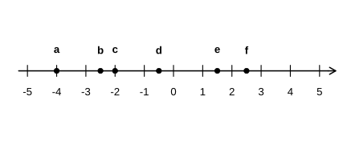

# Assignment 98

> **Definition 12.1.1** (Positive and Negative Numbers)  To denote quantities of opposite meaning, such as temperatures above and below zero, or income and expenditure, two kinds of numbers are needed. The numbers studied before (such as $6, 500, 4.7, \frac{3}{8}$) are positive numbers; numbers obtained by prefixing a "-" (minus sign) to them (such as $-6, -500, -4.7, -\frac{3}{8}$) are negative numbers. The "+" (plus sign) in front of a positive number may be omitted. $0$ is neither positive nor negative.
>
> **Definition 12.1.2** (Reading Positive and Negative Numbers)  For a negative number, read "negative" first and then the number; for example, $-3$ is read "negative three", and $-\frac{3}{8}$ is read "negative three eighths". When a "+" is prefixed to a positive number it is read "positive ..."; for example, $+3$ is read "positive three". Usually the "+" is omitted and the number is read directly.
>
> **Definition 12.1.3** (Representing Positive and Negative Numbers on the Number Line)  Numbers are represented by points on an arrowed line; the point $0$ on the line is the dividing point (origin). Numbers to the right of $0$ are positive, and numbers to the left of $0$ are negative. Positive and negative numbers denote quantities of opposite meaning: opposite directions correspond to opposite signs.

### Exercise 1

(Lesson: Understanding Negative Numbers, Do It, Problem 1) Which temperature is lower, $-3\,^{\circ}\mathrm{C}$ or $-18\,^{\circ}\mathrm{C}$?

### Solution to Exercise 1

By **Definition 12.1.1** (Positive and Negative Numbers), sub-zero temperatures carry a minus sign, and the more negative the number the lower the temperature. Since $-18$ is smaller than $-3$, $-18\,^{\circ}\mathrm{C}$ is the lower temperature. $\blacksquare$

### Exercise 2

(Lesson: Understanding Negative Numbers, Do It, Problem 2) Read the following numbers aloud and state which are positive and which are negative: $-7$, $2.5$, $0$, $-\frac{5}{2}$, $-5.2$, $+41$, $-\frac{3}{4}$, $+\frac{1}{5}$.

### Solution to Exercise 2

By **Definition 12.1.1** (Positive and Negative Numbers) and **Definition 12.1.2** (Reading Positive and Negative Numbers): the positive numbers are $2.5$, $+41$, $+\frac{1}{5}$; the negative numbers are $-7$, $-\frac{5}{2}$, $-5.2$, $-\frac{3}{4}$; and $0$ is neither positive nor negative. $\blacksquare$

### Exercise 3

(Lesson: Number Line, Do It) Mark the following numbers on the number line: $-4$, $-2$, $2.5$, $-0.5$, $1.5$, $-\frac{5}{2}$.

### Solution to Exercise 3

By **Definition 12.1.3** (Representing Positive and Negative Numbers on the Number Line), to the right of $0$ mark $1.5$, $2.5$ in order; to the left of $0$ mark $-0.5$, $-2$, $-\frac{5}{2}=-2.5$, $-4$ in order. Their positions are shown below.

{width=50%}

$\blacksquare$

### Exercise 4

(Lesson: Exercise 1, Problem 1) On the Moon's surface the daytime temperature can reach $127\,^{\circ}\mathrm{C}$ above zero, recorded as $\_\_\,^{\circ}\mathrm{C}$; the nighttime temperature can reach $183\,^{\circ}\mathrm{C}$ below zero, recorded as $\_\_\,^{\circ}\mathrm{C}$.

### Solution to Exercise 4

By **Definition 12.1.1** (Positive and Negative Numbers), temperatures above zero are recorded as positive and below zero as negative: daytime is recorded as $+127\,^{\circ}\mathrm{C}$ (i.e. $127\,^{\circ}\mathrm{C}$); nighttime is recorded as $-183\,^{\circ}\mathrm{C}$. $\blacksquare$

### Exercise 5

(Lesson: Exercise 1, Problem 2) China takes the long-term mean sea level as the elevation datum, i.e. elevation $0\,\mathrm{m}$; elevation above sea level is positive and below sea level is negative. The elevation of Mount Everest is $\_\_\,\mathrm{m}$, and the elevation of the lowest point of the Turpan Basin is $\_\_\,\mathrm{m}$ (Mount Everest rises $8848.86\,\mathrm{m}$ above sea level, while the lowest point of the Turpan Basin lies $154.31\,\mathrm{m}$ below sea level).

### Solution to Exercise 5

By **Definition 12.1.1** (Positive and Negative Numbers), points above sea level are recorded as positive and below sea level as negative: Mount Everest's elevation is $+8848.86\,\mathrm{m}$ (i.e. $8848.86\,\mathrm{m}$); the lowest point of the Turpan Basin is $-154.31\,\mathrm{m}$. $\blacksquare$

### Exercise 6

(Lesson: Exercise 1, Problem 3) If Beijing time is recorded as $0$ o'clock, then relative to Beijing time, Tokyo is $1$ hour ahead and is recorded as $+1$ hour, while Paris is $7$ hours behind and is recorded as $-7$ hours. At this moment, it is $12{:}00$ in Beijing, $13{:}00$ in Tokyo, $5{:}00$ in Paris, $4{:}00$ in London, and $15{:}00$ in Sydney. Record Sydney time and London time in this way.

### Solution to Exercise 6

By **Definition 12.1.1** (Positive and Negative Numbers), times ahead of Beijing are recorded as positive and times behind as negative. Sydney at $15{:}00$ is $3$ hours ahead of Beijing at $12{:}00$, recorded as $+3$ hours; London at $4{:}00$ is $8$ hours behind Beijing at $12{:}00$, recorded as $-8$ hours. $\blacksquare$

### Exercise 7

(Lesson: Exercise 1, Problem 4) (1) If the warning level of a river is recorded as $0\,\mathrm{m}$ and positive numbers mean the water surface is above the warning level, then during flood season the level is $1.5\,\mathrm{m}$ above the warning level, recorded as $\_\_\,\mathrm{m}$; during the dry season the level is $3\,\mathrm{m}$ below the warning level, recorded as $\_\_\,\mathrm{m}$. (2) The standard net weight of a packaged food is $200\,\mathrm{g}$; if a net weight of $205\,\mathrm{g}$ is recorded as $+5\,\mathrm{g}$, then a net weight of $197\,\mathrm{g}$ is recorded as $\_\_\,\mathrm{g}$.

### Solution to Exercise 7

By **Definition 12.1.1** (Positive and Negative Numbers), values above the standard are recorded as positive and below as negative. (1) The flood-season level $1.5\,\mathrm{m}$ above is recorded as $+1.5\,\mathrm{m}$; the dry-season level $3\,\mathrm{m}$ below is recorded as $-3\,\mathrm{m}$. (2) $197\,\mathrm{g}$ is $3\,\mathrm{g}$ less than the standard $200\,\mathrm{g}$, so it is recorded as $-3\,\mathrm{g}$. $\blacksquare$

### Exercise 8

(Lesson: Exercise 1, Problem 5) The number line is marked with scales $-8, -6, -2, 0, 2, 4, 8$, and the points $A, B, C, D, E$ lie between the corresponding scales. Write the numbers represented by the points $A, B, C, D, E$.

### Solution to Exercise 8

By **Definition 12.1.3** (Representing Positive and Negative Numbers on the Number Line), numbers to the right of $0$ are positive and those to the left are negative; simply read off the value at each point's scale position (in the figure, point $A$ lies near $-8$; read off the numbers corresponding to $B, C, D, E$ in order toward the positive direction). $\blacksquare$

### Exercise 9

(Lesson: Exercise 1, Problem 6) Monthly income and expenditure for Xiaoming's family: parents' salary income totals $9500$ yuan; giving $2000$ yuan to the elderly at Spring Festival; giving $100$ yuan each to Xiaoming and his sister as New Year gifts; paying last month's utilities and other expenses of $400$ yuan; buying $800$ yuan of food; and buying new clothes for the $4$ family members, costing $1000$ yuan. Record income as positive and expenditure as negative, fill in the income-expenditure table, and compute the balance for this month.

### Solution to Exercise 9

By **Definition 12.1.1** (Positive and Negative Numbers), income is recorded as positive and expenditure as negative: parents' salary $+9500$; Spring Festival gift to the elderly $-2000$; New Year gifts to Xiaoming and his sister $-200$; utilities and other expenses $-400$; buying food $-800$; buying new clothes $-1000$. The balance is
$$9500-2000-200-400-800-1000=5100\text{ \left(元\right)}.$$
$\blacksquare$

### Exercise 10

(Lesson: Exercise 1, Problem 7) If $1$ grid on the number line represents $1\,\mathrm{m}$, point $A$ is at $-1$, and point $B$ is $3\,\mathrm{m}$ from point $A$. Mark the possible positions of point $B$ on the diagram.

### Solution to Exercise 10

By **Definition 12.1.3** (Representing Positive and Negative Numbers on the Number Line), point $B$ may lie on either side of point $A$. $3$ grids to the right: $-1+3=2$; $3$ grids to the left: $-1-3=-4$. Thus point $B$ may be at $2$ or at $-4$. $\blacksquare$

### Exercise 11

(Lesson: Exercise 1, Problem 8) A mall's revenue in month $1$ was $100$ ten-thousand yuan; in month $2$ it was $130$ ten-thousand yuan, a $\_\_\%$ increase over month $1$. In month $3$ it was $117$ ten-thousand yuan, a $10\%$ decrease over month $2$, called negative growth, which may also be recorded as a growth of $-10\%$. In month $4$ it was $111.15$ ten-thousand yuan, a $\_\_\%$ increase over month $3$. In month $5$ it was $111.15$ ten-thousand yuan, unchanged from month $4$, with a growth rate of $\_\_\%$, also called zero growth.

### Solution to Exercise 11

By **Definition 12.1.1** (Positive and Negative Numbers), a positive growth rate means growth and a negative one means a decrease. Month $2$ vs month $1$: $\left(130-100\right)\div100=30\%$, a $30\%$ increase. Month $4$ vs month $3$: $\left(111.15-117\right)\div117=-5\%$, i.e. a growth of $-5\%$. Month $5$ is unchanged from month $4$, so the growth rate is $0\%$. $\blacksquare$
