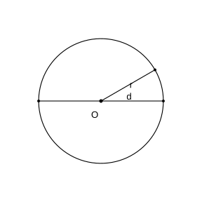
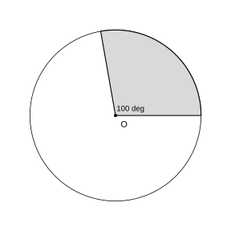

# 作业 93

> **定义 11.5.1** (圆各部分的名称)  圆规针尖固定的一点叫圆心, 用 $O$ 表示; 连接圆心和圆上任意一点的线段叫半径, 用 $r$ 表示; 通过圆心并且两端都在圆上的线段叫直径, 用 $d$ 表示. 同一个圆里 $d=2r$. 墨子云: "圆, 一中同长也".
>
> **定义 11.5.2** (弧, 扇形, 圆心角)  圆上两点之间的部分叫弧; 一条弧和经过这条弧两端的两条半径所围成的图形叫扇形; 顶点在圆心的角叫圆心角. 同一个圆中, 扇形的大小与圆心角的大小有关.
>
> **定义 11.5.3** (圆周率)  任意一个圆的周长除以它的直径, 所得的商是一个固定的数, 叫圆周率, 用 $\pi$ 表示. 它是无限不循环小数, 计算时通常取 $\pi\approx3.14$.
>
> **定义 11.5.4** (圆的周长)  围成圆的曲线的长叫圆的周长, $C=\pi d=2\pi r$.
>
> **定义 11.5.5** (圆的面积)  圆所占平面的大小叫圆的面积. 把圆等分拼成近似长方形, 长为 $\pi r$, 宽为 $r$, 故 $S=\pi r^2$.

### 练习一百三十三

(课时 圆的认识 例1) 用圆规画圆: 在纸上确定点 $O$, 把圆规两脚分开定好距离, 有针尖的脚固定在点 $O$, 有笔芯的脚旋转一周. 说一说用圆规画圆时要注意什么.

### 解答 练习一百三十三

由**定义 11.5.1** (圆各部分的名称), 有针尖的脚要固定不动, 旋转圆规时两脚间的距离不能变. 圆心决定圆的位置, 半径决定圆的大小. $\blacksquare$

### 练习一百三十四

(课时 圆的认识 做一做 第 1 题) 用圆规画几个不同大小的圆, 剪下来沿着直径折一折, 画一画, 你有什么发现? 在左边以 $O$ 为圆心画两个不同大小的圆, 在右边画三个相同大小的圆.

### 解答 练习一百三十四

一个圆的半径有无数条, 直径有无数条; 同一个圆所有半径都相等, 所有直径都相等, 直径长度是半径的 $2$ 倍; 把圆沿任何一条直径对折, 两边可以重合. $\blacksquare$

### 练习一百三十五

(课时 圆的认识 做一做 第 2 题) 用圆规画一个半径是 $2\,\text{cm}$ 的圆, 并分别用字母 $O$, $r$, $d$ 标出它的圆心, 半径和直径.

{width=50%}

### 解答 练习一百三十五

由**定义 11.5.1** (圆各部分的名称), 定圆心 $O$, 两脚距 $2\,\text{cm}$ 画圆, 标出半径 $r=2\,\text{cm}$ 和直径 $d=4\,\text{cm}$. $\blacksquare$

### 练习一百三十六

(课时 圆的认识 做一做 第 3 题) 对于用杯口画出的圆, 如何找到圆心?

### 解答 练习一百三十六

把圆形纸片对折两次, 两条折痕 (直径) 的交点就是圆心. $\blacksquare$

### 练习一百三十七

(课时 圆的认识 例2) 圆上 $A$, $B$ 两点之间的部分叫弧, 读作"弧 $AB$". 一条弧和经过这条弧两端的两条半径所围成的图形叫扇形. 像 $\angle AOB$ 这样顶点在圆心的角叫圆心角.

### 解答 练习一百三十七

由**定义 11.5.2** (弧, 扇形, 圆心角), 在同一个圆中画几个不同大小的扇形, 可发现扇形的大小与圆心角的大小有关; 以半圆为弧的圆心角是 $180^{\circ}$, 以四分之一圆为弧的圆心角是 $90^{\circ}$. $\blacksquare$

### 练习一百三十八

(课时 圆的认识 做一做) 指出物体中的扇形. 先画一个半径是 $2\,\text{cm}$ 的圆, 再在该圆中画一个圆心角是 $100^{\circ}$ 的扇形.

{width=50%}

### 解答 练习一百三十八

由**定义 11.5.2** (弧, 扇形, 圆心角), 画 $r=2\,\text{cm}$ 的圆, 用量角器在圆心处画 $100^{\circ}$ 的角, 角的两边与弧围成扇形. $\blacksquare$

### 练习一百三十九

(课时 圆的认识 练习十 复习巩固 第 1 题) 按下面的要求用圆规画圆: (1) $r=3\,\text{cm}$; (2) $d=5\,\text{cm}$; (3) $r=3.5\,\text{cm}$.

### 解答 练习一百三十九

由**定义 11.5.1** (圆各部分的名称): (1) 两脚距 $3\,\text{cm}$; (2) $d=5\,\text{cm}$ 则 $r=2.5\,\text{cm}$, 两脚距 $2.5\,\text{cm}$; (3) 两脚距 $3.5\,\text{cm}$. 分别画圆. $\blacksquare$

### 练习一百四十

(课时 圆的认识 练习十 复习巩固 第 2 题) 填表 (单位: m): 已知直径 $0.24$, $1.42$, $0.86$, $1.04$, 求半径.

### 解答 练习一百四十

由**定义 11.5.1** (圆各部分的名称), $r=d\div2$: 半径依次为 $0.12$, $0.71$, $0.43$, $0.52\,\text{m}$. $\blacksquare$

### 练习一百四十一

(课时 圆的认识 练习十 复习巩固 第 3 题) 用方法测量没有标出圆心的圆的直径.

### 解答 练习一百四十一

把一把三角尺的一条直角边靠在直尺上, 另一条直角边夹住圆, 移动使圆两边都与直角边接触, 两直角边间的距离就是直径 (最长弦). $\blacksquare$

### 练习一百四十二

(课时 圆的认识 练习十 复习巩固 第 4 题) 根据对称轴画出轴对称图形的另外一半.

### 解答 练习一百四十二

由轴对称性质, 找到已知部分各顶点关于对称轴的对称点 (到轴的距离相等), 依次连线画出另一半. $\blacksquare$

### 练习一百四十三

(课时 圆的认识 练习十 复习巩固 第 5 题) 下面图形中哪些角是圆心角? 在 ( ) 里画"√". 扇形是轴对称图形吗? 能找到几条对称轴?

### 解答 练习一百四十三

由**定义 11.5.2** (弧, 扇形, 圆心角), 顶点在圆心的角是圆心角. 扇形是轴对称图形, 只有 $1$ 条对称轴 (过圆心和弧中点的直线). $\blacksquare$

### 练习一百四十四

(课时 圆的认识 练习十 综合运用 第 6 题) 学校要建一个直径是 $10\,\text{m}$ 的圆形花坛, 你能用什么方法画出这个圆?

### 解答 练习一百四十四

$r=5\,\text{m}$. 在地面定一点为圆心, 找一根 $5\,\text{m}$ 长的绳子一端固定在圆心, 另一端拉直绕一周即可画出圆. $\blacksquare$

### 练习一百四十五

(课时 圆的认识 练习十 综合运用 第 7 题) 看图填空: 圆柱高 $3.5\,\text{cm}$, 底面直径 $10\,\text{cm}$, 求 $d$.

### 解答 练习一百四十五

图中长方形内画两个等圆, 长 $10\,\text{cm}$ 是两条直径之和, 故 $d=10\div2=5\,\text{cm}$. $\blacksquare$

### 练习一百四十六

(课时 圆的认识 练习十 综合运用 第 8 题) 长方形中有三个大小相等的圆, 长方形的长是 $18\,\text{cm}$. 圆的直径是多少? 长方形的周长是多少?

### 解答 练习一百四十六

$18\,\text{cm}$ 是 $3$ 条直径之和, $d=18\div3=6\,\text{cm}$; 长方形宽等于直径 $6\,\text{cm}$, 周长 $=(18+6)\times2=48\,\text{cm}$. $\blacksquare$

### 练习一百四十七

(课时 圆的认识 练习十 综合运用 第 9 题) 在下列图形中分别画出几条对称轴? 我们学过的平面图形中哪些是轴对称图形? 哪些只有一条对称轴?

### 解答 练习一百四十七

圆有无数条对称轴; 正方形 $4$ 条, 等边三角形 $3$ 条, 长方形 $2$ 条, 等腰三角形 $1$ 条, 扇形 $1$ 条. $\blacksquare$

### 练习一百四十八

(课时 圆的认识 练习十 拓展提升 第 10 题) 以一个等边三角形的三个顶点为圆心, 以边长为半径画圆, 最终可以画出哪种图案?

### 解答 练习一百四十八

三个圆两两相交, 形成像三瓣花的图案 (每个圆都经过另两个圆的圆心). $\blacksquare$

### 练习一百四十九

(课时 圆的周长 例3) 圆桌和菜板边缘需要箍一圈铁皮. 量出一些圆的周长和直径, 用周长除以直径, 你发现了什么?

### 解答 练习一百四十九

一个圆的周长总是它的直径的 $3$ 倍多一些. 由**定义 11.5.3** (圆周率), 周长除以直径的商是固定的数 $\pi$. 故圆的周长 $C=\pi d=2\pi r$. $\blacksquare$

### 练习一百五十

(课时 圆的周长 例4) 一辆汽车轮子直径是 $75\,\text{cm}$. 轮子转 $1$ 圈, 汽车走多远? 若汽车行驶总里程 $4710\,\text{km}$, 轮子一共转了多少圈?

### 解答 练习一百五十

由**定义 11.5.4** (圆的周长), $C=3.14\times75=235.5\,\text{cm}=2.355\,\text{m}$. $4710\,\text{km}=4710000\,\text{m}$, $4710000\div2.355=2000000$ (圈). $\blacksquare$

### 练习一百五十一

(课时 圆的周长 做一做 第 1 题) 求下面各圆的周长: $d=8\,\text{cm}$; $r=3\,\text{cm}$; $r=5\,\text{cm}$. 皮尺量得圆桌面周长 $6.28\,\text{m}$, 直径是多少?

### 解答 练习一百五十一

由**定义 11.5.4** (圆的周长): $3.14\times8=25.12\,\text{cm}$; $2\times3.14\times3=18.84\,\text{cm}$; $2\times3.14\times5=31.4\,\text{cm}$; 直径 $6.28\div3.14=2\,\text{m}$. $\blacksquare$

### 练习一百五十二

(课时 圆的周长 练习十一 复习巩固 第 1 题) 一个圆形喷水池的半径是 $5\,\text{m}$, 它的周长是多少米?

### 解答 练习一百五十二

由**定义 11.5.4** (圆的周长): $2\times3.14\times5=31.4\,\text{m}$. $\blacksquare$

### 练习一百五十三

(课时 圆的周长 练习十一 复习巩固 第 2 题) 在一个圆形亭子里, 小丽沿直径从一端走 $12$ 步到达另一端, 每步长约 $55\,\text{cm}$. 这个圆的周长大约是多少米?

### 解答 练习一百五十三

直径 $=12\times55=660\,\text{cm}=6.6\,\text{m}$, 周长 $=3.14\times6.6=20.724\,\text{m}$. $\blacksquare$

### 练习一百五十四

(课时 圆的周长 练习十一 复习巩固 第 3 题) 一个古代建筑中大红圆柱横截面的周长是 $3.14\,\text{m}$. 这个圆柱横截面的直径是多少米?

### 解答 练习一百五十四

$3.14\div3.14=1\,\text{m}$. $\blacksquare$

### 练习一百五十五

(课时 圆的周长 练习十一 复习巩固 第 4 题) 杂技演员独轮车车轮直径 $40\,\text{cm}$, 要骑过 $50.24\,\text{m}$ 长的钢丝, 车轮大约要转动多少圈?

### 解答 练习一百五十五

车轮周长 $3.14\times40=125.6\,\text{cm}=1.256\,\text{m}$; $50.24\div1.256=40$ (圈). $\blacksquare$

### 练习一百五十六

(课时 圆的周长 练习十一 综合运用 第 5 题) 一只挂钟的分针长 $20\,\text{cm}$, 经过 $30$ 分钟后, 分针的尖端所走的路程是多少厘米? 经过 $45$ 分钟呢?

### 解答 练习一百五十六

分针尖端走一圈 $2\times3.14\times20=125.6\,\text{cm}$. $30$ 分钟走半圈 $=62.8\,\text{cm}$; $45$ 分钟走 $\frac{3}{4}$ 圈 $=94.2\,\text{cm}$. $\blacksquare$

### 练习一百五十七

(课时 圆的周长 练习十一 综合运用 第 6 题) 一个圆形牛栏半径 $15\,\text{m}$, 至少要用多长的粗铁丝才能把牛栏围上 $3$ 圈? 如果每隔 $2\,\text{m}$ 打一根木桩, 大约要打多少根?

### 解答 练习一百五十七

围一圈 $2\times3.14\times15=94.2\,\text{m}$, $3$ 圈 $282.6\,\text{m}$. 木桩数 $94.2\div2\approx47$ (根). $\blacksquare$

### 练习一百五十八

(课时 圆的周长 练习十一 综合运用 第 7 题) 看图填空: (1) 正方形内最大圆 $r=2$, 正方形周长 $\_\_$, 圆周长 $\_\_$; (2) 长方形内两个等圆 $r=1.5$, 一个圆周长 $\_\_$, 长方形周长 $\_\_$.

### 解答 练习一百五十八

(1) 正方形边长 $=d=4$, 周长 $16\,\text{cm}$; 圆周长 $3.14\times4=12.56\,\text{cm}$. (2) 圆周长 $2\times3.14\times1.5=9.42\,\text{cm}$; 长方形长 $=4r=6$, 宽 $=2r=3$, 周长 $(6+3)\times2=18\,\text{cm}$. $\blacksquare$

### 练习一百五十九

(课时 圆的周长 练习十一 综合运用 第 8 题) 在一个周长为 $100\,\text{cm}$ 的正方形纸片内, 要剪一个半径最大的圆, 这个圆的半径是多少厘米?

### 解答 练习一百五十九

正方形边长 $=100\div4=25\,\text{cm}$, 最大圆直径等于边长 $25\,\text{cm}$, 半径 $12.5\,\text{cm}$. $\blacksquare$

### 练习一百六十

(课时 圆的周长 练习十一 综合运用 第 9 题) 一扇窗户上装形状如右图的装饰彩灯, 由一个半圆和一个正方形组成, $d=50\,\text{cm}$. 大约需要多少米彩灯?

### 解答 练习一百六十

彩灯长度 $=$ 半圆周长 $+$ 三条边 $=\frac{1}{2}\times3.14\times50+50\times3=78.5+150=228.5\,\text{cm}=2.285\,\text{m}$. $\blacksquare$

### 练习一百六十一

(课时 圆的周长 练习十一 拓展提升 第 10 题) 下面图形的周长是多少厘米? 你是怎样计算的? (边长 $5\,\text{cm}$ 的正方形四周配四个半圆).

### 解答 练习一百六十一

四个半圆相当于两个整圆的周长: $2\times3.14\times5=31.4\,\text{cm}$. $\blacksquare$

### 练习一百六十二

(课时 圆的周长 练习十一 拓展提升 第 11 题) 把表格补充完整 (半径, 直径, 周长, 已知周长 $12.56$). 半径扩大到原来的 $n$ 倍, 直径扩大到原来的 ( ) 倍, 周长扩大到原来的 ( ) 倍.

### 解答 练习一百六十二

$d=12.56\div3.14=4\,\text{cm}$, $r=2\,\text{cm}$. 半径扩大 $n$ 倍, 直径扩大 $n$ 倍, 周长也扩大 $n$ 倍. $\blacksquare$

### 练习一百六十三

(课时 圆的周长 练习十一 拓展提升 第 12 题) 把圆柱形物体分别捆成不同形状 (接头处不计), 每组至少需要多长的绳子? 你发现了什么?

### 解答 练习一百六十三

绳子长度 $=$ 一个整圆周长 $+$ 若干条直径长度. 随着圆的个数增加, 直段部分变长, 弧段部分合起来仍是一个整圆. $\blacksquare$

### 练习一百六十四

(课时 圆的面积 例5) 一个圆半径为 $10\,\text{cm}$. 先数方格估计面积, 再把圆等分剪拼成近似长方形. 长方形的长近似于 $\pi r$, 宽近似于 $r$. 圆的面积公式是什么?

### 解答 练习一百六十四

由**定义 11.5.5** (圆的面积), 长方形面积 $=$ 长 $\times$ 宽 $=\pi r\times r=\pi r^2$, 故 $S=\pi r^2$. 等分份数越多, 拼成的图形越接近长方形. $\blacksquare$

### 练习一百六十五

(课时 圆的面积 例6) 风电机组叶轮半径为 $123\,\text{m}$, 叶轮扫风面积是多少? 标准足球场长 $105\,\text{m}$ 宽 $68\,\text{m}$, 扫风面积约相当于几个足球场? (得数保留整数.)

### 解答 练习一百六十五

由**定义 11.5.5** (圆的面积): $S=3.14\times123^2=3.14\times15129\approx47505\,\text{m}^2$. 足球场 $105\times68=7140\,\text{m}^2$, $47505\div7140\approx7$ (个). $\blacksquare$

### 练习一百六十六

(课时 圆的面积 做一做 第 1 题) 一个圆形茶几桌面直径是 $1\,\text{m}$, 它的面积是多少平方米? 一个圆形蓄水池周长约 $31.4\,\text{m}$, 它的占地面积约是多少?

### 解答 练习一百六十六

茶几 $r=0.5\,\text{m}$, $S=3.14\times0.5^2=0.785\,\text{m}^2$. 蓄水池 $r=31.4\div3.14\div2=5\,\text{m}$, $S=3.14\times25=78.5\,\text{m}^2$. $\blacksquare$

### 练习一百六十七

(课时 圆的面积 例7) "青玉御题蚕纹璧"是一个圆环, 外圆直径 $26.3\,\text{cm}$, 内圆直径 $5.4\,\text{cm}$. 这个圆环的面积是多少? (得数保留一位小数.)

### 解答 练习一百六十七

圆环面积 $=$ 外圆面积 $-$ 内圆面积 $=3.14\times(\frac{26.3}{2})^2-3.14\times(\frac{5.4}{2})^2=3.14\times(13.15^2-2.7^2)=3.14\times165.6325\approx520.1\,\text{cm}^2$. $\blacksquare$

### 练习一百六十八

(课时 圆的面积 例8) 求涂色部分面积: (1) 大半圆挖去小半圆再加小半圆 (半径 $5\,\text{cm}$); (2) 长方形 $r=3\,\text{cm}$, 上面半圆补到下面.

### 解答 练习一百六十八

(1) $3.14\times5^2\div2=39.25\,\text{cm}^2$; (2) 把上面半圆平移到下面, 涂色正好是长方形 $6\times3=18\,\text{cm}^2$. $\blacksquare$

### 练习一百六十九

(课时 圆的面积 做一做) 求下面各图形中涂色部分的面积 (单位: cm): (1) 圆环内圆半径 $4$, 环宽 $2$; (2) 长方形 $2+1+2$ 中涂色半圆; (3) 同心圆红色扇环.

### 解答 练习一百六十九

(1) 外半径 $6$, $3.14\times(6^2-4^2)=3.14\times20=62.8\,\text{cm}^2$; (2) 长方形长 $5$ 宽 $2$, 涂色部分拼成长方形 $3\times2=6\,\text{cm}^2$; (3) 按扇环面积公式 $\frac{n}{360}\pi(R^2-r^2)$ 计算. $\blacksquare$

### 练习一百七十

(课时 圆的面积 例9) 研究"外方内圆"和"外圆内方"中正方形和圆之间的关系. 假设圆半径为 $a$.

### 解答 练习一百七十

"外方内圆": 正方形边长 $=d=2a$, 面积 $4a^2$, 圆面积 $\pi a^2$, 圆是正方形的 $\frac{\pi}{4}$. "外圆内方": 正方形看作两个三角形, 面积 $2a^2$, 圆是正方形的 $\frac{\pi}{2}$. 把两个图形叠在一起, 大正方形面积是小正方形的 $2$ 倍. $\blacksquare$

### 练习一百七十一

(课时 圆的面积 做一做) 已知图中正方形的面积是 $20\,\text{cm}^2$, 圆的面积是多少平方厘米? 涂色部分的面积是多少?

### 解答 练习一百七十一

由**练习一百七十**, 圆是正方形的 $\frac{\pi}{4}$: 圆面积 $20\times\frac{\pi}{4}=5\pi\approx15.7\,\text{cm}^2$; 涂色 $20-15.7=4.3\,\text{cm}^2$. $\blacksquare$

### 练习一百七十二

(课时 圆的面积 练习十二 复习巩固 第 1 题) 把表格补充完整: 已知直径 $4\,\text{cm}$, $9\,\text{cm}$, $6\,\text{cm}$, $20\,\text{cm}$, 求半径和面积.

### 解答 练习一百七十二

$d=4$: $r=2$, $S=12.56\,\text{cm}^2$; $d=9$: $r=4.5$, $S=63.585\,\text{cm}^2$; $d=6$: $r=3$, $S=28.26\,\text{cm}^2$; $d=20$: $r=10$, $S=314\,\text{cm}^2$. $\blacksquare$

### 练习一百七十三

(课时 圆的面积 练习十二 复习巩固 第 2 题) 计算下面各圆的周长和面积: $d=10\,\text{cm}$; $r=3\,\text{cm}$.

### 解答 练习一百七十三

$d=10$: $C=31.4\,\text{cm}$, $S=78.5\,\text{cm}^2$; $r=3$: $C=18.84\,\text{cm}$, $S=28.26\,\text{cm}^2$. $\blacksquare$

### 练习一百七十四

(课时 圆的面积 练习十二 复习巩固 第 3 题) 公园草地上一个自动旋转喷灌装置的射程是 $10\,\text{m}$, 它能喷灌的面积是多少?

### 解答 练习一百七十四

$S=3.14\times10^2=314\,\text{m}^2$. $\blacksquare$

### 练习一百七十五

(课时 圆的面积 练习十二 复习巩固 第 4 题) 一棵树干横截面的周长是 $125.6\,\text{cm}$. 横截面近似于圆, 它的面积大约是多少?

### 解答 练习一百七十五

$r=125.6\div3.14\div2=20\,\text{cm}$, $S=3.14\times20^2=1256\,\text{cm}^2$. $\blacksquare$

### 练习一百七十六

(课时 圆的面积 练习十二 复习巩固 第 5 题) 一个圆形环岛直径为 $50\,\text{m}$, 中间是一个直径为 $10\,\text{m}$ 的圆形花坛, 其他地方是草坪. 草坪的占地面积是多少?

### 解答 练习一百七十六

$3.14\times(25^2-5^2)=3.14\times600=1884\,\text{m}^2$. $\blacksquare$

### 练习一百七十七

(课时 圆的面积 练习十二 复习巩固 第 6 题) 下面两个图中, 大圆的半径均等于小圆的直径, 求涂色部分的面积. 你发现了什么?

### 解答 练习一百七十七

设小圆半径 $r$, 大圆半径 $2r$. 涂色面积 $=\pi(2r)^2-\pi r^2=3\pi r^2$, 即大圆面积的 $\frac{3}{4}$. $\blacksquare$

### 练习一百七十八

(课时 圆的面积 练习十二 复习巩固 第 7 题) 一枚铜钱, 圆的直径为 $28\,\text{mm}$, 中间正方形边长为 $6\,\text{mm}$. 这枚铜钱的面积是多少?

### 解答 练习一百七十八

$3.14\times14^2-6^2=615.44-36=579.44\,\text{mm}^2$. $\blacksquare$

### 练习一百七十九

(课时 圆的面积 练习十二 综合运用 第 8 题) 在生活里找找圆环形物体, 测量所需数据, 计算出它的面积.

### 解答 练习一百七十九

如卫生纸筒横截面, 金属垫片. 量出外圆半径 $R$ 和内圆半径 $r$, 圆环面积 $=\pi(R^2-r^2)$. $\blacksquare$

### 练习一百八十

(课时 圆的面积 练习十二 综合运用 第 9 题) 一个运动场两端是半圆形, 中间是长方形, 长 $100\,\text{m}$, 宽 $32\,\text{m}$. 这个运动场的周长是多少米? 面积是多少平方米?

### 解答 练习一百八十

周长 $=$ 圆周长 $+$ 两条直道 $=3.14\times32+100\times2=100.48+200=300.48\,\text{m}$. 面积 $=3.14\times16^2+100\times32=803.84+3200=4003.84\,\text{m}^2$. $\blacksquare$

### 练习一百八十一

(课时 圆的面积 练习十二 综合运用 第 10 题) 花瓣状门洞的边是由 $4$ 个直径都是 $1\,\text{m}$ 的半圆组成的. 这个门洞的周长和面积分别是多少?

### 解答 练习一百八十一

周长 $=4\times\frac{1}{2}\times3.14\times1=6.28\,\text{m}$. 面积 $=$ 正方形 $1\times1+2$ 个整圆 $=1+3.14\times0.5^2\times2=1+1.57=2.57\,\text{m}^2$. $\blacksquare$

### 练习一百八十二

(课时 圆的面积 练习十二 综合运用 第 11 题) 两座圆环形土楼, 一座外直径 $34\,\text{m}$ 内直径 $14\,\text{m}$, 另一座外直径 $26\,\text{m}$ 内直径 $14\,\text{m}$. 两座土楼的房屋占地面积相差多少?

### 解答 练习一百八十二

$3.14\times(17^2-7^2)-3.14\times(13^2-7^2)=3.14\times(289-49-169+49)=3.14\times120=376.8\,\text{m}^2$. $\blacksquare$

### 练习一百八十三

(课时 圆的面积 练习十二 综合运用 第 12 题) 一个圆的周长是 $62.8\,\text{m}$, 半径增加 $2\,\text{m}$ 后, 面积增加多少?

### 解答 练习一百八十三

原来 $r=62.8\div3.14\div2=10\,\text{m}$, 新 $r=12\,\text{m}$. 增加 $3.14\times(12^2-10^2)=3.14\times44=138.16\,\text{m}^2$. $\blacksquare$

### 练习一百八十四

(课时 圆的面积 练习十二 综合运用 第 13 题) 公园有两块一样大的半圆形草坪, 它们的周长都是 $128.5\,\text{m}$. 这两块草坪的总面积是多少?

### 解答 练习一百八十四

半圆周长 $=\pi r+2r=r(\pi+2)=128.5$, $r=128.5\div5.14=25\,\text{m}$. 两个半圆拼成一个整圆, 面积 $3.14\times25^2=1962.5\,\text{m}^2$. $\blacksquare$

### 练习一百八十五

(课时 圆的面积 练习十二 拓展提升 第 14 题) 从圆环上截取的部分叫扇环. 求扇环面积: $r=4\,\text{dm}$, $R=5\,\text{dm}$ (圆心角 $90^{\circ}$).

### 解答 练习一百八十五

扇环面积 $=\frac{90}{360}\times3.14\times(5^2-4^2)=\frac{1}{4}\times3.14\times9=7.065\,\text{dm}^2$. $\blacksquare$

### 练习一百八十六

(课时 圆的面积 练习十二 拓展提升 第 15 题) 两个相同的半圆叠拼而成, $\triangle ABC$ 是等腰直角三角形, $AB=BC=10\,\text{dm}$. 涂色部分面积是多少平方分米?

### 解答 练习一百八十六

两个半圆面积 $- $ 三角形面积 $=2\times\frac{1}{2}\times3.14\times5^2-\frac{1}{2}\times10\times10=78.5-50=28.5\,\text{dm}^2$. $\blacksquare$

### 练习一百八十七

(课时 圆的面积 练习十二 拓展提升 第 16 题) 长方形建筑物, 墙角有一根木桩, 拴狗的绳子长 $4\,\text{m}$. 这条狗活动区域的面积有多大?

### 解答 练习一百八十七

狗以绳长 $4\,\text{m}$ 为半径绕墙角, 活动区域是 $\frac{3}{4}$ 个圆: $\frac{3}{4}\times3.14\times4^2=37.68\,\text{m}^2$. $\blacksquare$

### 练习一百八十八

(课时 圆的面积 练习十二 拓展提升 第 17 题) (1) 一根绳子长 $31.4\,\text{m}$, 用这根绳子在操场上围出一块地. 怎样围面积最大? (2) 为什么草原上蒙古包的底面是圆形的? 为什么绝大多数植物的根和茎横截面是圆形的?

### 解答 练习一百八十八

(1) $31.4$ 是圆周长时 $r=5\,\text{m}$, 面积 $78.5\,\text{m}^2$, 同样周长围成圆时面积最大. (2) 同样的材料, 圆形底面能获得最大面积, 故蒙古包做成圆形; 根茎横截面圆形有利于输送水分并节省材料. $\blacksquare$

### 练习一百八十九

(课时 利用圆设计图案) 用圆规和直尺一步一步画出教材中的图案. 你对"圆心决定圆的位置, 半径决定圆的大小"有了更深的感受吗?

### 解答 练习一百八十九

按教材图示, 先画大圆, 再以大圆半径为直径在各方向画小圆, 即可形成对称的花朵图案. $\blacksquare$

### 练习一百九十

(课时 整理和复习 练习十三 复习巩固 第 1 题) "中国天眼"上方圈梁是一个直径为 $500\,\text{m}$ 的圆. 工程师沿着圈梁走一圈, 大约是多少米?

### 解答 练习一百九十

$C=3.14\times500=1570\,\text{m}$. $\blacksquare$

### 练习一百九十一

(课时 整理和复习 练习十三 复习巩固 第 2 题) 双面绣作品绣在直径是 $20\,\text{cm}$ 的圆面上. 这个圆的面积是多少?

### 解答 练习一百九十一

$r=10\,\text{cm}$, $S=3.14\times10^2=314\,\text{cm}^2$. $\blacksquare$

### 练习一百九十二

(课时 整理和复习 练习十三 复习巩固 第 3 题) 用 $10\,\text{m}$ 长的铁条做直径是 $50\,\text{cm}$ 的圆形铁环, 最多可以做多少个?

### 解答 练习一百九十二

一个铁环周长 $3.14\times50=157\,\text{cm}=1.57\,\text{m}$, $10\div1.57\approx6$ (个). $\blacksquare$

### 练习一百九十三

(课时 整理和复习 练习十三 复习巩固 第 4 题) 儿童乐园圆形旋转木马直径 $8\,\text{m}$, 周边还要留出 $1\,\text{m}$ 宽的小路, 并在外侧围上栏杆. 栏杆内的占地面积是多少平方米?

### 解答 练习一百九十三

外半径 $=4+1=5\,\text{m}$, $S=3.14\times5^2=78.5\,\text{m}^2$. $\blacksquare$

### 练习一百九十四

(课时 整理和复习 练习十三 综合运用 第 5 题) 已知图中正方形的面积是 $10\,\text{cm}^2$, 圆的面积是多少平方厘米?

### 解答 练习一百九十四

外方内圆中圆是正方形的 $\frac{\pi}{4}$: $10\times\frac{\pi}{4}=2.5\pi\approx7.85\,\text{cm}^2$. $\blacksquare$

### 练习一百九十五

(课时 整理和复习 练习十三 综合运用 第 6 题) 压路机前轮直径 $1.7\,\text{m}$, 每分钟转动 $6$ 圈, 压路机 $10$ 分钟前进多远?

### 解答 练习一百九十五

前轮周长 $3.14\times1.7=5.338\,\text{m}$, 每分钟 $5.338\times6=32.028\,\text{m}$, $10$ 分钟 $320.28\,\text{m}$. $\blacksquare$

### 练习一百九十六

(课时 整理和复习 练习十三 综合运用 第 7 题) 一个图形中间是边长 $1\,\text{cm}$ 的正方形, 四周是四个圆心角 $90^{\circ}$ 的扇形. 整个图形的周长和面积是多少?

### 解答 练习一百九十六

四个扇形合起来是一个半径 $1\,\text{cm}$ 的整圆. 周长 $=2\times3.14\times1=6.28\,\text{cm}$; 面积 $=1+3.14\times1^2=4.14\,\text{cm}^2$. $\blacksquare$

### 练习一百九十七

(课时 整理和复习 练习十三 综合运用 第 8 题) "10 米气步枪"标靶: 九环区域外圆直径约 $5.5\,\text{mm}$, 十环是中间小圆, 直径 $0.5\,\text{mm}$. 十环面积是九环面积的几分之几?

### 解答 练习一百九十七

面积比 $=$ 直径比的平方: $(\frac{0.5}{5.5})^2=\frac{1}{121}$. $\blacksquare$

### 练习一百九十八

(课时 整理和复习 练习十三 拓展提升 第 9 题) 大三角形和小三角形都是等边三角形, 圆和大三角形三边各有一个交点, $AD=DB=BE=EC=CF=FA$. 小三角形面积是 $60\,\text{cm}^2$, 大三角形面积是多少?

### 解答 练习一百九十八

由题意, 小三角形各顶点是大三角形各边的中点, 连接中点把大三角形分成 $4$ 个全等的小三角形. 大三角形面积 $=60\times4=240\,\text{cm}^2$. $\blacksquare$
